# 匿名聊天室：架構文件

> 這份文件寫給「不寫程式的專案主人」看。
> 每個專有名詞第一次出現時，都會用一句話解釋。
> 這份文件只講「怎麼設計」，不含任何程式碼。畫面的顏色和樣式交給 `/design`，實際把畫面做出來交給 `/frontend-design`。

---

## 目錄

1. [專案說明與目標](#1-專案說明與目標)
2. [整體架構圖](#2-整體架構圖)
3. [技術選擇](#3-技術選擇)
4. [兩個階段，以及怎麼避免重寫](#4-兩個階段以及怎麼避免重寫)
5. [通訊約定](#5-通訊約定)
6. [資料流](#6-資料流)
7. [畫面清單](#7-畫面清單)
8. [金鑰](#8-金鑰)
9. [安全與限制](#9-安全與限制)
10. [這一版刻意不做的事](#10-這一版刻意不做的事)
11. [repo 的資料夾結構](#11-repo-的資料夾結構)
12. [部署到 GitHub Pages](#12-部署到-github-pages)
13. [驗證清單](#13-驗證清單)

---

## 1. 專案說明與目標

### 這是什麼

一個可愛療癒風格的**即時聊天室**，有兩個聊天室：

- **「好多人」**：匿名的多人群組。任何知道網址的人，輸入一個匿名暱稱、挑一個頭像，就能進來跟大家聊天。
- **「兩個人」**：只有你（縵，也就是站長）和訪客一對一的聊天室。訪客輸入自己的名字，就能單獨跟你聊天，別的訪客看不到。

訪客**不用註冊，也不用登入**。只有你（縵）需要一個登入入口，才能看到所有訪客跟你的對話。

「即時」的意思是：有人送出訊息，對方的畫面上幾乎立刻就會出現，不需要重新整理網頁。

#### 兩種身分

| 身分 | 是誰 | 能進哪裡 |
|---|---|---|
| 訪客 | 任何知道網址的人，不用登入 | 一個「好多人」群組，加上最多**一個**跟 縵 的一對一聊天室 |
| 縵（站長） | 你，需要登入 | 「好多人」群組（用匿名暱稱，和訪客一樣）+ 所有訪客的一對一聊天室 |

**訪客與訪客之間不能互相私聊、不能加好友**。訪客只會有「好多人」和「兩個人」這兩個聊天室，不會有任何可以跟別的訪客聊天的聊天室。

### 目標

| 目標 | 說明 |
|---|---|
| 零門檻 | 打開網頁、取個名字、挑個頭像就能聊 |
| 不蒐集個資 | 訪客不用提供 Email、電話，也不用登入。名字想填什麼都可以（「兩個人」聊天室只是建議填自己的名字，不會驗證）。只有站長 縵 一個人要登入 |
| 電腦、手機、平板都好用 | 同一套網頁，畫面會依螢幕大小調整 |
| 可愛柔和 | 馬卡龍色系，有兩個主題：「馬卡龍」（預設，淺色）與「星夜」（深色，深紫底配粉彩亮點） |
| 免費就能跑 | 只用免費方案：GitHub Pages 與 Supabase 的免費方案 |

### 使用者能做的事（已和你確認過的規則）

**入口與兩個分頁**

- **第一個畫面：選身分**。打開網址，先看到兩個身分：
  - **「訪客」**：任何人。
  - **「縵」**：站長（你）。
- **點「訪客」**，出現兩個選項：
  - **「好多人」**：只要匿名輸入一個名稱就能進去。不用代碼，也不用登入。
  - **「兩個人」**：跟 縵 一對一聊天。進去會看到**兩個框：先輸入名字，再輸入自己預設的數字**（第一次進來時自己設的那組代碼）。名字用來找出是哪個對話，數字當密碼。名字框旁有小標語「輸入自己的名字」。第一次來的人，按「第一次來？設定我的名字和數字」，自己設定名字、數字（四位或六位）和頭像。
- **點「縵」**：要輸入帳號和密碼登入（第一次使用時，在這個畫面建立帳號）。
- 以訪客身分進去之後，上方有「**好多人**」「**兩個人**」兩個分頁可以隨時切換，不用回到選擇畫面。
- **下次打開網址**：
  - 訪客：直接進上次待的那個分頁。「好多人」的名稱和頭像都記得；「兩個人」要不要再輸入數字，看下面「記得此裝置」的規則。
  - 縵：被記得的裝置直接是登入狀態；沒被記得的要重新登入。
- 畫面上有一個選單可以回到第一個畫面（選身分）。

**「好多人」群組的規則**

- **暱稱**：長度 1～20 字，可以用中文、英文、數字和 emoji，可以有空格但前後不能有、也不能連續兩個空格。同一時間不能有兩個人用同一個暱稱，撞名就要換。瀏覽器會記住上次的暱稱，下次打開直接進聊天室，畫面上留一個「換暱稱」按鈕。
- **頭像**：進來時可以三選一：從一排可愛頭像中挑一個、從自己手機或電腦的**相簿選一張照片**、或**開啟相機當場拍一張**。照片會先裁成正方形（可以拖曳和縮放調整），再縮小成小圖。照片頭像會**公開給聊天室所有人看**，而且會保存到使用者按下「**刪除我的照片**」為止，所以入口畫面會提醒使用者「建議不要用可辨識本人的照片」。按下刪除後，這個人所有上傳過的照片都會從伺服器移除，**已經送出的舊訊息裡的頭像也會變成預設頭像**，而且無法復原。
- **看歷史訊息**：進來先看到最近 50 則，往上滑可以載入更早的。**文字訊息永久保留**，除非發送者自己收回。但語音、圖片、影片檔案會過期（見下面「檔案自動過期」）。
- **送訊息**：文字最多 2000 字，一則訊息最多可以附 10 張照片，文字和照片能一起送。也可以傳**檔案**（見下面「傳檔案」）。圖片從手機或電腦的相簿選取（不跳出網站）；要傳網址，直接打在輸入框裡當文字就好，不另外做貼圖片網址的功能。
- **防刷屏**：送出後，送出按鈕會短暫變灰約 0.5 秒，之後才能再送。
- **表情回應**：每則訊息下方會把大家按過的 emoji 疊在一起顯示（不顯示數字），旁邊有一個「＋」。點「＋」開啟選擇器：最上面一排是「放大鏡」加分類（最近使用、表情、動物……）；沒按放大鏡時不顯示搜尋框，按了放大鏡才出現搜尋輸入框。選擇器裡沒有說明文字。**同一個人對同一則訊息最多只能有 1 種表情**：按另一種就是改選，再按一次同樣的就取消。想知道是誰按的，點一下那個表情，下方會冒出一個奶茶色的小提示框（箭頭朝上指著表情），列出按的人。
- **收回訊息**：長按自己的訊息，選「收回」。這則訊息在聊天室原本的位置，變成一個置中的小字「收回」，樣子和「有人進來／離開」的提示一樣，不另外跳出訊息被收回的框。想救回來，就長按那個小字，跳出「復原」。沒有時間限制。
- **公告**：長按任何一則訊息（自己的或別人的），選「設為公告」。分頁列下方有一朵小花，浮在訊息上面，不佔位置，訊息可以捲到分頁列下面；小花可以用手左右拖動。點小花會打開「曾經設為公告的訊息」列表，點其中一則會跳回它原本的位置。目前的公告有標示。
- **整體配色**：分頁列最左邊有一顆展開箭頭；「好多人」那邊的分頁列與展開後的框是淡綠色，「兩個人」那邊整塊最上面（分頁列、展開的框、縵單一對話的標題列）是淡黃色。輸入列由左到右：藍色麥克風（長按說話）、黃色圖片（直接開相簿）、輸入框（右邊有淡紫色小笑臉）、粉色送出。輸入框的提示文字是「說話！」。
- **換主題**：在選單（⋯）裡有一列「換主題」，前面是調色盤圖示，右邊兩顆小色塊：左邊粉紅加黃（馬卡龍）、右邊淺紫加深粉（星夜），目前使用的有外圈。「好多人」「兩個人」與縵的一對一聊天選單都有。只影響自己的畫面，瀏覽器會記住選擇。畫面上不另外放主題按鈕。
- **在線名單**：頂部可以摺疊展開，顯示頭像和暱稱。自己標「（我）」，排在最上面，其他人依進來的先後排。
- **進出提示**：有人進來或離開，對話區中間會出現一行置中的小字。
- **Emoji 面板**：只有電腦與筆電會跳出。點一個 Emoji 就插入輸入框，面板自動關閉。手機按笑臉則直接使用手機鍵盤的 Emoji，沒有面板。
- **新訊息提示**：你正往上翻舊訊息時，畫面不會自動捲動，下方出現「↓ N 則新訊息」按鈕。
- **斷線處理**：網路中斷時頂部顯示「重新連線中」，連回來後自動補上錯過的訊息，斷線期間打的文字訊息會先暫存起來，連線後出現在輸入列上方，由你自己決定要不要送出（不會自動送出）。

**「兩個人」一對一聊天室的規則**

下面沒提到的功能（文字、圖片、表情回應、收回與復原、防刷屏、斷線暫存、Emoji 面板、新訊息提示），規則都和群組完全一樣。**悄悄話是這裡獨有的功能**，見下面。差別在於這裡只有訪客和 縵 兩個人，而且對話會永久保留。

- **名字**：訪客自己輸入，旁邊的小標語是「輸入自己的名字」。可以用中文、英文、數字、emoji，長度 1～20 字，**可以和別人重複**（因為每個訪客的對話是分開的）。「縵」「系統」「管理員」這類保留字不能用。
- **頭像**：和群組的頭像分開選，也可以按一下「沿用群組的頭像」。之後想改隨時可以改。選項和群組一樣：內建頭像、相簿照片、相機拍照。
- **自己設一組代碼**：第一次進來，訪客要設一組**代碼**，用來日後換手機或清除瀏覽器資料後找回對話。代碼可以選**四位數或六位數**，預設四位數。提示文字不建議用生日，而是「選一組你記得住、別人猜不到的數字」。
- **每次進入都要輸入「名字加代碼」**：進「兩個人」要輸入自己的名字和預設的數字。第一次是設定，之後是輸入。換了手機或清除了瀏覽器資料，輸入同一組名字加代碼，就能接回舊對話，兩個裝置之後都能繼續聊同一個對話。連續輸錯 5 次，這個名字會暫時鎖住一段時間。
- **記得此裝置**：輸入名字加代碼成功之後，會問訪客「要記得這個裝置嗎？」
  - **要**：這台裝置之後進「兩個人」不用再輸入代碼。
  - **這次先不要**：以後每次進「兩個人」都要輸入代碼，包括同一個瀏覽器。離開頁面約 30 分鐘後，就要重新輸入。
  - **預設是每次都要輸入**：沒回答之前，不會自動記得。
  - **反悔可以再改**：「兩個人」分頁的選單有「記得這個裝置」開關，隨時能打開或關閉；另有「忘記我所有的裝置」，所有裝置之後都要重新輸入代碼。
  - **久沒用自動忘記**：被記得的裝置，30 天沒用就自動忘記。
- **找不回來的情況**：如果訪客忘了代碼，又換了裝置或清了資料，就找不回舊對話，只能重新開一個新的。縵 那邊的舊對話仍然保留。
- **清空我這邊的畫面**：訪客可以隨時清空自己看到的對話，只影響他自己，縵 那邊的對話還在。清空後，他再回來只看得到之後的新訊息。**訪客不能刪掉整個對話**。
- **縵 的在線狀態與已讀**：訪客預設**看不到** 縵 在不在線，也看不到「已讀」。這兩項由 縵 自己決定要不要公開，預設都不公開。
- **被封鎖時**：訪客看得到舊對話，但送不出新訊息，畫面只顯示「目前無法傳送訊息」，**不會告訴他被封鎖了**。
- **悄悄話（會消失的聊天）**：**只有「兩個人」有悄悄話，「好多人」群組只有一般聊天，沒有這個功能。** 在「兩個人」，標題列右邊有兩顆模式按鈕：太陽是「💬 一般聊天」，流星是「🫧 悄悄話」。太陽是平常的聊天，訊息會保留；第二個「🫧 悄悄話」按下去，這個對話（你和 縵 兩個人）一起進入悄悄話分段，任何一方都能按：
  - 這一段用**虛線**框起來，上方標示「🫧 悄悄話進行中」，雙方的畫面都看得到。
  - 分段裡所有功能都能用：文字、選相簿圖片、表情回應、收回（網址直接打在文字裡）。
  - 任何一方按回「💬 一般聊天」，這一段的訊息在**雙方**的畫面上立刻消失，伺服器上也真的刪掉。這一段之前的一般訊息不受影響。
  - 你自己離開畫面（關分頁、重新整理、換頁）再回來，看不到離開前的悄悄話，只看得到回來之後的新悄悄話。
  - 如果兩個人都離開了、沒有人按回按鈕，伺服器會在約 1～2 分鐘後自動結束並刪掉這一段。
  - 分段消失後，原位置留一行置中灰字「🫧 一段悄悄話已結束並清除」，不寫細節。
  - 兩次切換之間只有 0.5 秒冷卻，不用等提示消失就能直接切換。按回一般聊天前會先跳出確認視窗。
  - 悄悄話**不是加密**，也擋不住截圖、拍照，或有人用程式在分段進行中把訊息抄下來。

**縵（站長）的畫面**

- **建立帳號與登入**：在第一個畫面點「縵」，會要求輸入 Email 和密碼。
  - **第一次**：在這個畫面最下面左邊點「第一次登入」，輸入 Email 當帳號，以及兩次密碼（**至少 8 個字元**），帳號就建好了，**同時登記為站長**（寫進 `site_owner` 清單）。這個動作**只有在還沒有站長的時候才會成功**，成功一次之後就永遠關閉，沒有人能再建立第二個站長。
  - **之後**：輸入同一組 Email 和密碼登入。
  - **誰是站長，永遠只看 `site_owner` 清單**。隨便註冊的帳號不在清單上，不是站長，什麼都看不到。
  - **忘記密碼**：這個專案不寄信，所以沒有「寄重設信」。忘記時，到 Supabase 後台的使用者頁面直接幫這個帳號設定新密碼。
- **記得這個裝置**：每次登入或建立帳號時，會問你「要記得這個裝置嗎？」
  - **要**：這個裝置下次打開網頁，直接是登入狀態，不用再輸入密碼。
  - **不要**：關掉瀏覽器後就登出，下次要重新輸入密碼。
  - **反悔可以再改**：「設定」裡有「已登入的裝置」清單，顯示每個裝置的名稱和最近使用時間。你可以隨時對目前這個裝置打開或關閉「記得」，也可以對其他裝置按「忘記此裝置」，那個裝置會立刻失去站長權限，要重新輸入密碼。另有「登出所有其他裝置」一鍵按鈕。
  - **久沒用自動忘記**：一個被記得的裝置，超過 30 天沒用，會自動被忘記。
- 登入後，上方同樣有「好多人」和「兩個人」兩個分頁。
- **「好多人」**：和訪客一樣的畫面。你用一個匿名暱稱和頭像加入，**沒有任何特別標記，別人不知道哪個是你**。
- **「兩個人」**：一份對話列表，每個訪客一列，顯示名字、頭像、最後一則訊息、時間、未讀數，最新的排最上面。點進去就是那個人的一對一對話。
- **管理一個對話**：可以**封鎖**、**解除封鎖**、**刪除整個對話**。封鎖與解除封鎖都不會通知對方。刪除是兩邊都真的刪掉，無法復原。
- **置頂對話**：縵 可以把任一個對話置頂，數量不限。置頂的對話固定排在「所有對話」列表最上面的「置頂」區，不受新訊息排序影響；在單一對話右上角的選單可以置頂或取消置頂。
- **兩個開關**：「公開我的在線狀態」「公開已讀」，預設都**關閉**。
- **通知**：只在網頁開著時有效：對話列表上的未讀數字、瀏覽器分頁標題（例如「(3) 縵」）、提示音（可關）、瀏覽器通知。**關掉網頁就收不到**。
- 你看不到訪客的在線狀態和已讀，你只看未讀數。

---

## 2. 整體架構圖

先認識三個角色：

- **瀏覽器**：使用者手上的 Chrome、Safari 等。聊天室的畫面就跑在這裡。
- **GitHub Pages**：GitHub 提供的免費網頁主機。它只負責「把網頁檔案交給瀏覽器」，**不負責聊天**。
- **Supabase**：一個雲端後端服務。它負責「記住訊息」「把新訊息即時推給對方」「存圖片」「認得誰是站長」。

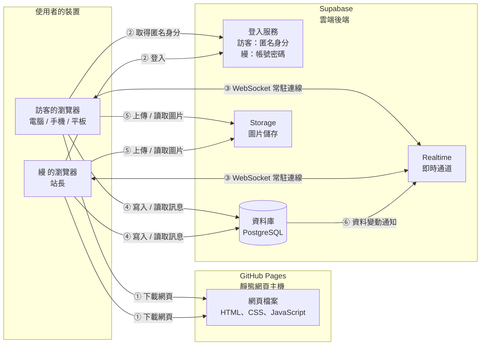

**兩種聊天室，在資料庫裡是同一套東西**：「好多人」和每一個「訪客與 縵 的一對一聊天室」，在資料庫裡都叫一個**房間**。每則訊息都標記自己屬於哪個房間；規則（誰能讀、誰能寫）依房間種類不同：

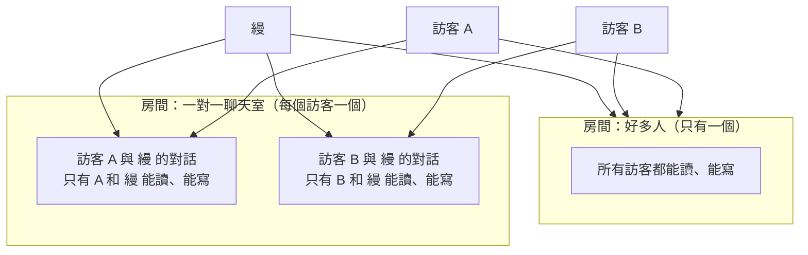

訪客 A 和訪客 B 之間**沒有任何連線**，他們不可能看到彼此的一對一對話，也無法私聊。

怎麼讀這張圖：

1. 使用者輸入網址，瀏覽器向 **GitHub Pages** 下載網頁。這一步只發生一次。
2. 網頁跑起來之後，瀏覽器直接跟 **Supabase** 說話，**中間沒有我們自己架的伺服器**。
3. 瀏覽器和 Supabase 之間維持一條 **WebSocket**（一條開著不關的雙向連線，伺服器有新消息可以主動推給你，不用你一直問）。
4. 有人送出訊息，訊息先寫進資料庫，資料庫再通知 Realtime，Realtime 立刻推給所有連線中的人。

> 因為沒有自己的伺服器，所有「規則」都要靠 Supabase 資料庫本身擋住（第 9 章會講）。這是這個架構最重要的一個前提。

---

## 3. 技術選擇

每一項都寫「選了什麼」和「為什麼」。

### 3.1 前端（使用者看到的網頁）

| 項目 | 選了什麼 | 為什麼 |
|---|---|---|
| 語言 | **HTML + CSS + JavaScript**（瀏覽器天生就看得懂的三兄弟） | 不需要額外安裝任何東西，就能在瀏覽器跑 |
| 框架 | **不使用框架**，用原生 JavaScript，程式拆成多個「模組」檔案 | 聊天室只有一個主畫面，規模不大。不用框架就**不需要「建置」步驟**，也就是不用先把程式轉換打包才能發布。檔案放上 GitHub Pages 就能直接運作，對你最單純，出問題也最好查 |
| 模組 | **ES Modules**（JavaScript 內建的「把程式拆成多個檔案再互相引用」的標準功能） | 能把「畫面」「資料」「通訊」分開放，是第 4 章「不用重寫」的基礎 |
| Supabase 的 JavaScript 套件 | 階段二才加入，用 **CDN**（網路上的公用檔案庫，直接用網址引入，不用安裝）載入，並**鎖定固定版本** | 一樣不需要建置。鎖定版本是為了避免對方更新後，你的網頁突然壞掉 |

**沒選 React、Vue 之類的框架**，原因不是它們不好，而是這個專案用不到它們的優勢，卻要多付「需要建置、多一層學習成本」的代價。

### 3.2 Supabase 用到的功能

Supabase 提供很多功能，這個專案只用下面這些：

| 功能 | 白話解釋 | 在這個專案做什麼 | 為什麼選它 |
|---|---|---|---|
| **匿名登入**（Anonymous Sign-ins） | 不需要帳號密碼，由 Supabase 自動給每個瀏覽器一個隨機的身分編號，存在瀏覽器裡 | 讓系統能認得「這則訊息是不是你發的」，才能做到只有發送者能收回、同一人不能重複按同一個表情 | 符合「訪客不用註冊登入、不收個資」。訪客完全看不到這個過程，也沒有任何帳號。要注意：清除瀏覽器網站資料後，會得到新身分，之前發的訊息就再也不能收回；一對一聊天室則要靠「代碼」找回（第 5.4 節） |
| **帳號密碼登入**（Email + Password，只給 縵 一個人） | 傳統的帳號加密碼登入，由 Supabase 負責驗證 | 讓 縵 登入，系統才能確認「這個人是站長」，把所有訪客的一對一對話交給 縵 | 站長需要一個**真正可驗證的身分**，不能像訪客一樣用匿名身分。只有一個站長帳號，由你在網站上第一次登入時建立，同時登記為站長。「這個人是不是站長」由資料庫裡的一張 `site_owner` 清單決定，**不是**看誰有帳號或誰登入過。登入時可以選擇「記得這個裝置」，記得與忘記由資料庫裡的一張裝置清單控制，可以隨時撤銷單一裝置。可選擇開啟兩步驟驗證（MFA） |
| **pgcrypto**（資料庫的加密工具） | PostgreSQL 內建的工具，可以把文字加密成無法還原的「雜湊」 | 把訪客設定的代碼加密後才存，資料庫裡不會有明文代碼 | 就算資料庫內容外洩，也看不到訪客的代碼 |
| **資料庫（PostgreSQL）** | 一個存放表格資料的地方，像很多張 Excel 表 | 存訊息、表情回應、悄悄話分段的狀態 | 訊息要永久保留，需要真正的資料庫 |
| **pg_cron**（資料庫的定時工作） | 讓資料庫每隔一段時間自己執行一件事，像鬧鐘 | 每分鐘檢查一次，把「兩個人都已離開、卻沒人按回一般聊天」的悄悄話分段（只有一對一聊天室有）自動結束並刪除 | 因為沒有自己的伺服器，需要資料庫自己負責這個清理。Supabase 免費方案有提供，在後台開啟即可 |
| **Realtime** | Supabase 的即時推播功能 | 有新訊息、有人按表情、有人收回時，立刻通知所有人；也用它的 Broadcast（對所有人喊話）功能，在有人刪除照片頭像時通知大家 | 這就是你說的「WebSocket 即時傳訊」 |
| **Presence**（Realtime 的一部分） | 「誰現在在線上」的即時登記簿，人一離線就自動消失 | 做在線人數、在線名單、進出提示，以及判斷暱稱有沒有被佔用 | 線上狀態不需要永久保存，用 Presence 剛好，不會把資料庫塞滿 |
| **Storage** | Supabase 的檔案儲存空間 | 存使用者上傳的訊息圖片，以及照片頭像（兩者放在不同的資料夾，規則分開設定） | 圖片不適合直接塞進資料庫 |

**刻意不用**：Supabase 的 Edge Functions（在雲端跑自訂程式的功能）、社群登入（Google、Facebook 等）、寄信功能（Email 驗證、忘記密碼信、通知信）。這一版不需要，少用就少一個出錯的地方。你的站長帳號在網站上第一次登入時建立，後台要把「Confirm email（寄驗證信）」關掉，所以不需要寄任何信。（免費方案內建的寄信功能有數量與收件人限制，驗證信可能寄不出去，登入會卡住。）

### 3.3 資料庫的規則怎麼保護

資料庫有一套叫 **RLS**（Row Level Security，列級安全）的機制：可以對每張表設定「誰可以讀、誰可以寫哪幾列」。因為沒有自己的伺服器，**RLS 就是這個專案的守門員**。主要規則放在第 5.4 節。

---

## 4. 兩個階段，以及怎麼避免重寫

你指定的順序是：**先把前端做好放上 GitHub Pages，最後才接 Supabase**。

### 4.1 階段一：還沒接 Supabase

**目標**：做出完整的聊天室外觀和操作，放上 GitHub Pages，大家用網址就能看到並點著玩。

**前端能做到什麼程度**：

| 項目 | 階段一的表現 |
|---|---|
| 所有畫面 | 第 7 章列的全部畫面都做完 |
| 第一個畫面（選身分）、訪客的兩個選項、「好多人」「兩個人」兩個分頁 | 完整可用 |
| 暱稱、頭像、換暱稱 | 完整可用，記住在瀏覽器。照片頭像（相簿、相機、裁切、刪除我的照片）也完整可用，照片只留在這個瀏覽器 |
| 「兩個人」一對一聊天室（名字、代碼、找回、清空我這邊的畫面） | 完整可用。代碼在這個瀏覽器裡驗證，只用來展示流程。縵 會以「示範回覆」自動回幾句話 |
| 「縵」登入入口、縵 的畫面（第一次建立帳號、記得此裝置、對話列表、未讀數、封鎖、解除封鎖、刪除、兩個公開開關、已登入的裝置清單） | 完整可用，但是**示範版**：第一次設定的帳號和密碼會記在瀏覽器裡，之後要輸入同一組才能登入，輸錯會顯示「帳號或密碼不對」（但這只是示範，不是真正安全的驗證，正式的驗證在階段二交給 Supabase），「記得此裝置」只是用瀏覽器儲存模擬，列表裡有幾位示範訪客。同一個瀏覽器的多個分頁會互相同步，所以你可以一個分頁當訪客、一個分頁當 縵，看到完整的來回效果 |
| Emoji 面板 | 完整可用 |
| 送文字、送圖片 | 可用。圖片會先在瀏覽器裡縮小再顯示，只留在這個瀏覽器裡 |
| 防刷屏倒數 | 完整可用 |
| 表情回應、收回、復原 | 完整可用 |
| 悄悄話分段（切換、虛線、確認、清除、離開後看不到） | 完整可用，同一個瀏覽器的多個分頁會互相同步；示範 縵 的回覆也會出現在悄悄話裡；只有「兩個人」有悄悄話 |
| 在線名單、進出提示 | 用「示範住戶」模擬 |
| 斷線提示 | 選單裡沒有「模擬斷線」按鈕。要測試畫面時，在瀏覽器開發者工具的 Console 輸入 `__ch3hw.service.setConnection({status:'offline'})`（恢復用 `'connected'`） |

**做不到的事**：你的訊息**別人看不到**。階段一沒有真正的伺服器，每個瀏覽器自成一個小世界。

**怎麼讓階段一看起來像有人在聊天**：

- 內建 3 位**示範住戶**（例如小雲、麻糬、布丁），會不定時說話、按表情、進出。
- **跨裝置同步（階段二）**：訊息存在伺服器。訪客用同一組名字和數字在筆電、手機各進一次，兩邊看到同一份對話，任何一邊傳的訊息、收回、表情另一邊都即時看到；縵用筆電或手機登入也一樣，在筆電回覆後，手機上已經是回過的狀態（已讀、未讀數也同步）。階段一示範模式資料在各自的瀏覽器，不同裝置之間不會互通，只有同一個瀏覽器的分頁會同步。
- 同一個瀏覽器開兩個分頁，兩個分頁會互相同步，用 BroadcastChannel（瀏覽器內建、讓同一個瀏覽器的分頁彼此傳話的功能），方便你自己測試「兩個人聊天」的效果。
- 畫面上方有一條小提示：「示範模式：訊息只存在你的瀏覽器」，避免大家誤會。

**怎麼在 GitHub Pages 上看到**：第 12 章。

### 4.2 階段二：接上 Supabase 之後

階段二**畫面完全不變**，改變的只有「訊息從哪裡來、到哪裡去」：

| 項目 | 階段一 | 階段二 |
|---|---|---|
| 訊息存哪 | 瀏覽器本機 | Supabase 資料庫（永久，所有人共用） |
| 其他人看得到嗎 | 看不到 | 看得到，即時 |
| 在線名單 | 示範住戶 | Presence，真正的人 |
| 暱稱撞名 | 跟示範住戶比 | 跟真正在線的人比 |
| 縵 登入 | 示範版，隨便輸入都能進 | 真正的帳號密碼登入，只有 `site_owner` 清單上的那個帳號是站長 |
| 一對一聊天室的存取 | 全在這個瀏覽器，沒有隔離 | 資料庫規則：訪客只能看到自己的那一個，縵 看得到全部 |
| 代碼找回 | 在瀏覽器裡驗證，只是展示 | 資料庫驗證，加密儲存，輸錯 5 次鎖定 |
| 縵 的未讀數、通知 | 同一個瀏覽器內的分頁之間 | 真正的訪客傳訊息，網頁開著時即時通知 |
| 圖片 | 只留在這個瀏覽器 | 傳到 Storage，所有人看得到 |
| 照片頭像 | 只留在這個瀏覽器 | 傳到 Storage 的頭像資料夾，所有人看得到 |
| 防刷屏 | 只有畫面倒數 | 畫面倒數 + 資料庫也擋 |
| 收回 | 只是改本機狀態 | 資料庫真正把內容藏起來（第 5.4 節） |
| 示範住戶、示範模式提示 | 有 | 移除 |

#### 4.2.1 階段二的實作紀錄（照實寫，不是理想）

- **連線元件**：官方的 supabase-js（固定版本 2.117.2，MIT 授權）下載後放在 `js/vendor/supabase.umd.js`，網站直接載入，不依賴外部網站，也不需要建置。
- **兩個連線**：`vc`（匿名登入，「好多人」與訪客的「兩個人」用）、`oc`（縵的 Email＋密碼登入，縵的對話與管理用）。縵在「好多人」發言用的是 `vc` 的匿名身分，所以資料庫看不出誰是縵。畫面上縵自己的訊息一律靠右（`supabaseService.js` 把 `vc` 身分在縵的畫面裡換成縵自己的編號）。
- **縵的登入憑證放哪**：記得這台裝置 → localStorage；不記得 → sessionStorage（只在這個分頁）。
- **訊息的 `media` 欄位**：存圖片、檔案、語音、影片的 `{id: Storage 路徑, …}`，畫面用 `mediaUrl()` 把路徑換成公開網址。
- **即時推播**：`messages`、`reactions`、`secret_sessions`、`announcements` 走 Realtime 的資料庫變動通知（RLS 照樣生效）。`hidden_items` **不推播**：資料庫的刪除通知不受 RLS 過濾，會把別人刪了什麼洩漏出去，所以「只刪我這邊」只在自己的瀏覽器即時更新，其他裝置重新載入時才看到。
- **在線名單與撞名**：用 Presence。撞名檢查是前端比對在線名單，不是資料庫保證，兩個人在約 2 秒內同時用同一個名字可能都進得去（見 9.3）。
- **縵的在線狀態**：縵公開時才在專用頻道登記；縵的「已讀」訪客每 20 秒詢問一次，不是即時。
- **還沒做的**：
  1. **過期檔案的真正刪除**（Edge Function）。目前畫面會顯示「已過期」，但檔案還留在 Storage 裡，免費額度約 1GB，要定期補上或手動清。
  2. Face ID／指紋與 6 位數字快速登入（8.2.2）、Email 忘記密碼（8.2.3，需要先接寄信服務）。
  3. 訪客的 `owner:readAt` 即時推播。
- **測試方式**：九份 SQL 在模擬的 PostgreSQL 上用 80 個情境測過；`supabaseService` 用兩個瀏覽器對真的 Supabase 測過訪客這側（好多人、兩個人、悄悄話、收回、表情、圖片與頭像上傳）。**縵這側沒有在真的 Supabase 上測**，因為建立站長是一次性的，由你自己第一次登入時完成。
- **網址加 `?backend=mock`**：回到示範模式，方便不連線時測畫面。

### 4.3 怎麼設計才不用整個重寫

做法是在「畫面」和「資料來源」之間，放一個**固定的介面**（可以想成一個插座規格）。

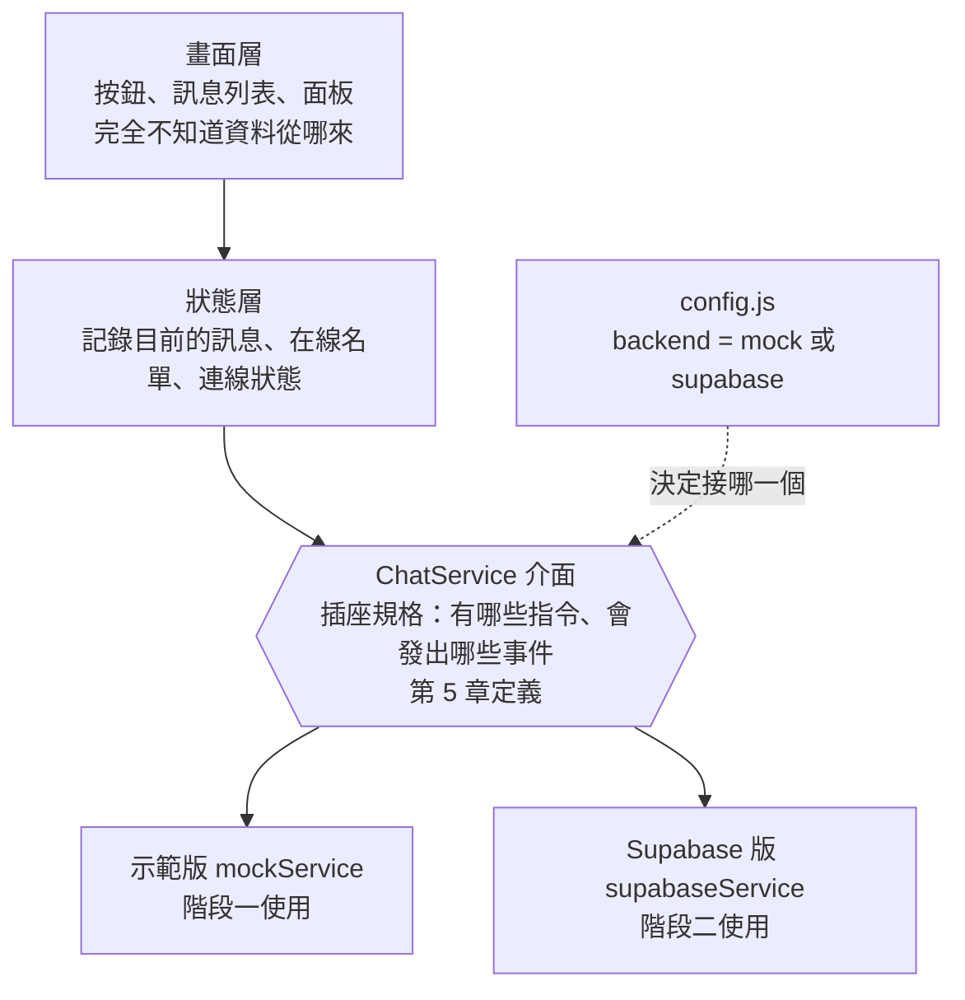

三個重點：

1. **畫面只跟 ChatService 說話**，從不直接碰 Supabase。畫面程式裡一行 Supabase 都不會出現。
2. **兩個版本（mock 與 supabase）提供一模一樣的指令和事件**。第 5 章就是這份規格。
3. **切換只改一個設定**：`config.js` 裡的 `backend`，從 `mock` 改成 `supabase`。

所以階段二的工作量是「新寫一個 supabaseService 檔案，加上在 Supabase 後台建好資料表」，**畫面、狀態、驗證規則都不用動**。

另外，輸入檢查（暱稱長度、訊息長度、圖片大小等）集中放在一個 `validators` 檔案，兩個階段共用，避免兩邊標準不一致。

---

## 5. 通訊約定

這一章是畫面與資料來源之間的**合約**。階段一的示範版和階段二的 Supabase 版，都要照這份合約做。

命名規則：事件名稱用「**分類:動作**」，全部小寫英文，例如 `message:new`。

### 5.0 先看懂：房間（room）

「好多人」群組和每一個「訪客與 縵 的一對一聊天室」，在系統裡都叫一個**房間**，有各自的 `roomId`：

- 「好多人」的 `roomId` 是固定的（寫在設定裡），只有一個。
- 每個一對一聊天室有自己的 `roomId`，由系統在訪客第一次開啟時建立。

**所有跟訊息有關的指令和事件，都多帶一個 `roomId`**，表示這件事發生在哪個房間。下面的表格為了簡潔，只在不言而喻的地方省略，**凡是提到訊息、表情回應、收回、復原、悄悄話、載入歷史的，都要帶 `roomId`**。

### 5.1 指令（畫面 → ChatService）

**訪客與 縵 共用的指令**（都要帶 `roomId`，除非另有說明）：

| 指令 | 帶什麼資料 | 做什麼 |
|---|---|---|
| `join` | `{ nickname, avatar }` | 進入「好多人」群組（不帶 `roomId`）。暱稱被佔用時失敗並回報原因 |
| `leave` | 無 | 離開聊天室（換暱稱前也會呼叫） |
| `deleteMyAvatars` | 無 | 刪除自己上傳過的所有照片頭像，並通知其他人。頭像會改回預設頭像，使用者可以再挑別的 |
| `loadRecent` | 無 | 載入最近 50 則一般聊天訊息（含各訊息的表情回應）、（一對一聊天室才有）這段時間內曾經存在的悄悄話分段（用來標出「已結束並清除」那一行），以及目前進行中的分段與你進來之後的悄悄話訊息 |
| `loadOlder` | `{ beforeCreatedAt, beforeId }` | 往前再載入 50 則更早的訊息 |
| `sendMessage` | `{ id, text, images, file }`（文字、圖片、檔案至少要有一個） | 送出訊息。`id` 由前端先產生，`images` 是從相簿選的 0～10 張圖片，`file` 是 0～1 個檔案（文件或壓縮檔，50MB 以內） |
| `recallMessage` | `{ messageId }` | 收回自己的訊息 |
| `restoreMessage` | `{ messageId }` | 復原自己收回的訊息 |
| `startSecret` | 無 | 開始悄悄話分段（雙方一起）。**只有一對一聊天室可用**，對「好多人」呼叫一律失敗（`secret_not_allowed`）。已經有進行中的分段、或還在冷卻時失敗 |
| `endSecret` | 無 | 結束悄悄話分段：這一段的訊息對雙方清除。沒有進行中的分段、或還在冷卻時失敗 |
| `toggleReaction` | `{ messageId, emoji }` | 表情回應：沒按過就加上；按的是自己目前選的同一個 emoji 就取消；按的是不同 emoji 就改選（把原本的換成新的） |

**訪客專用：「兩個人」一對一聊天室**：

| 指令 | 帶什麼資料 | 做什麼 |
|---|---|---|
| `createDm` | `{ name, avatar, code, codeLength, rememberDevice }` | 第一次開啟跟 縵 的聊天室。`codeLength` 是 4 或 6。每個訪客只能開一個；已經有的話失敗。成功後這個房間立刻解鎖，並依 `rememberDevice` 決定這台裝置之後要不要免輸入代碼 |
| `unlockDm` | `{ name, code, rememberDevice }` | 輸入「名字加代碼」進入「兩個人」。用途有兩種：在新裝置上接回舊對話（這個裝置也成為成員），或在同一台裝置上「沒被記得」時再次進入。成功後解鎖約 30 分鐘（有操作會自動延長）。連續輸錯 5 次會鎖住這個名字一段時間 |
| `setDmRemember` | `{ roomId, remember }` | 對目前這台裝置，打開或關閉「記得此裝置」 |
| `forgetMyDevices` | `{ roomId }` | 忘記我所有的裝置：所有裝置之後都要重新輸入代碼 |
| `touchDm` | `{ roomId }` | 對話開著時，每約 5 分鐘自動呼叫一次，延長解鎖時間 |
| `clearMyView` | `{ roomId }` | 清空「我這邊」看到的對話，只影響訪客自己，縵 那邊的對話還在 |
| `watchOwnerStatus` | 無 | 開始接收 縵 公開的在線狀態與已讀（縵 沒公開就什麼都收不到） |

**縵 專用**（需要站長登入）：

| 指令 | 帶什麼資料 | 做什麼 |
|---|---|---|
| `ownerClaim` | `{ email, password, rememberDevice }` | **第一次**建立站長帳號並登記為站長。只有在 `site_owner` 還是空的時候才會成功；已經有站長就一律失敗（`claim_closed`） |
| `ownerLogin` | `{ email, password, rememberDevice }` | 站長登入。不是站長會失敗。`rememberDevice` 為 `true` 時，這個裝置之後免輸入密碼 |
| `ownerLogout` | 無 | 登出 |
| `listOwnerDevices` | 無 | 取得「已登入的裝置」清單（名稱、最近使用時間、是不是目前這台、是否被記得） |
| `setRememberThisDevice` | `{ remember }` | 對目前這台裝置，打開或關閉「記得此裝置」 |
| `forgetDevice` | `{ deviceId }` | 忘記某個裝置：該裝置立刻失去站長權限，要重新輸入密碼 |
| `signOutOtherDevices` | 無 | 忘記除了目前這台以外的所有裝置 |
| `listDms` | 無 | 取得所有一對一聊天室的摘要列表（見 5.3 的 DmSummary） |
| `markRead` | `{ roomId }` | 把這個對話標記為已讀（未讀數歸零） |
| `blockDm` | `{ roomId }` | 封鎖：這個訪客再也送不出新訊息。不會通知對方 |
| `unblockDm` | `{ roomId }` | 解除封鎖。不會通知對方 |
| `deleteDm` | `{ roomId }` | 刪除整個對話：訊息、表情回應、圖片都真的刪掉，無法復原。不會通知對方 |
| `setOwnerPrivacy` | `{ showOnline, showRead }` | 設定要不要公開在線狀態與已讀，預設兩個都是 `false` |

### 5.2 事件（ChatService → 畫面）

| 事件 | 帶什麼資料 | 什麼時候發出 |
|---|---|---|
| `connection:changed` | `{ status }`，`status` 是 `connected`、`reconnecting`、`offline` 其中之一 | 連線狀態改變 |
| `presence:sync` | `{ users: [使用者…] }` | 進入時，以及重新連線後，取得完整在線名單 |
| `presence:joined` | `{ user }` | 有人進來（畫面要顯示進入提示） |
| `presence:left` | `{ user }` | 有人離開（畫面要顯示離開提示） |
| `avatar:removed` | `{ userId }` | 有人刪除了自己的照片頭像。畫面要把這個人在訊息列表、在線名單裡的照片全部換成預設頭像（包含舊訊息） |
| `message:new` | `{ message }` | 有新訊息 |
| `message:recalled` | `{ messageId }` | 有訊息被收回 |
| `message:restored` | `{ message }` | 有訊息被復原，帶完整內容 |
| `reaction:added` | `{ messageId, emoji, user }` | 有人按了表情 |
| `reaction:removed` | `{ messageId, emoji, userId }` | 有人取消了表情。有人改選時，會依序收到一個 `removed`（舊的）和一個 `added`（新的） |
| `secret:started` | `{ segment: { id, startedAt } }` | 悄悄話分段開始（進入聊天室時如果已有進行中的分段，也會收到一次） |
| `secret:ended` | `{ segmentId, endedAt }` | 悄悄話分段結束。畫面要把這一段的所有訊息移除，換成「一段悄悄話已結束並清除」那一行 |
| `drafts:changed` | `{ drafts: [{ id, text, savedAt }] }` | 斷線期間暫存的訊息清單有變動（新增、送出、刪除、放回輸入框） |
| `owner:status` | `{ online }` | （訪客）縵 公開了在線狀態時，縵 上線或離線。縵 沒公開時，永遠收不到 |
| `owner:readAt` | `{ roomId, readAt }` | （訪客）縵 公開了已讀時，縵 看到了哪一則訊息之前的內容。縵 沒公開時，永遠收不到 |
| `dm:summary` | `{ dm: DmSummary }` | （縵）某個一對一聊天室有變動（新訊息、未讀數改變、被封鎖或解除封鎖），列表要更新那一列 |
| `dm:removed` | `{ roomId }` | （縵）某個一對一聊天室被刪除。（訪客）自己的聊天室被 縵 刪除，畫面回到「開啟聊天室」的狀態，不顯示原因 |
| `auth:changed` | `{ role }`，`role` 是 `visitor` 或 `owner` | 登入狀態改變 |
| `error:occurred` | `{ code, message }` | 任何指令失敗，例如 `nickname_taken`、`rate_limited`、`image_too_large` |

**實作時多出來的指令與事件**（設計稿的功能需要，階段二也要照做）：

| 名稱 | 說明 |
|---|---|
| `getSession` | 回傳這個瀏覽器目前的身分：訪客或縵、是否已有「兩個人」聊天室、這台裝置是否被記得（被記得就直接解鎖）、縵是否登入中 |
| `setAnnouncement` / `listAnnouncements` | 把一則訊息設為公告、取得公告紀錄。事件 `announcement:changed` |
| `pinDm` | 縵置頂或取消置頂一個對話（`DmSummary` 多一個 `pinned`） |
| `deleteMedia` | 手動刪除自己訊息裡的圖片、影片、語音或檔案（設為公告的圖片不會自動過期，只能手動刪） |
| `muteDm` | 縵靜音或取消靜音一個對話（`DmSummary` 多一個 `muted`） |
| `removeAnnouncement` | 把一則訊息從公告紀錄刪除（訊息本身還在）。事件 `announcement:changed` |
| `getOwnerProfile` / `updateOwnerProfile` | 縵在一對一對話裡顯示的名字與頭像（預設「縵」、`mm`）。事件 `owner:profile` 通知訪客更新標題列頭像。**階段二要存在伺服器（資料庫），不論縵用電腦或手機登入，看到和改的都是同一份，兩邊同步**；階段一示範模式只存在各自的瀏覽器，電腦和手機不會互通 |
| `updateDmProfile` | 訪客換「兩個人」的暱稱與頭像（只改縵看到的；登入用的名字與數字不變）。縵的對話列表上的名字、頭像跟著變 |
| `useVisitor` / `resumeOwner` | 在選身分畫面按「訪客」，這個分頁就一直是訪客；按「縵」且這台裝置被記得，就直接以縵進去 |
| `hideItem` / `unhideItem` / `purgeItem` | 「刪除（只有我這邊）」：把一則訊息，或「一段悄悄話已結束並清除」那行小字，從自己的畫面刪掉；復原；直接刪除（不能再復原）。`key` 是訊息編號，或 `seg:分段編號`。事件 `item:hidden`、`item:unhidden`、`item:purged`，只送給同一個人自己的其他分頁。階段二：資料庫存一張「誰刪了什麼、什麼時候」的表，只有本人讀得到，別人和縵都看不到；超過 1 天的由 pg_cron 清掉 |
| `getOwnerPrivacy` | 縵取得目前兩個公開開關的狀態 |
| `setConnection` | 只有示範模式用：模擬斷線與恢復 |
| 事件 `media:expired` | 圖片、語音、影片、檔案過期被刪掉（好多人 1 天、兩個人 3 天） |
| 訊息的 `images` / `file` / `voice` / `video` | 一則訊息最多 10 張圖片（`{id,w,h}`）、1 個檔案、1 則語音、1 支影片；階段一的 `id` 是瀏覽器本機的檔案編號，階段二換成 Storage 網址 |

### 5.3 資料格式

**使用者（User）**

```json
{
  "userId": "b3a1c2f0-0000-0000-0000-000000000001",
  "nickname": "小米",
  "avatar": "bear",
  "joinedAt": "2026-10-17T09:30:00.000Z"
}
```

- `userId`：匿名登入給的隨機編號，不含任何個資。
- `avatar`：頭像。有兩種寫法，畫面用有沒有 `https://` 開頭來分辨：
  - **內建頭像的代號**：清單固定，共 20 個插畫風小動物，挑選列的排列順序固定如下（最後 6 個要往下滑才看得到）：`crab`（螃蟹）、`duck`（小鴨）、`chick`（小雞）、`polarbear`（北極熊）、`cat`（貓）、`shark`（鯊魚）、`rabbit`（兔子，沒有蝴蝶結）、`koala`（無尾熊）、`elephant`（大象）、`dog`（狗狗）、`pig`（小豬）、`fish`（小魚）、`unicorn`（獨角獸）、`giraffe`（長頸鹿）、`tiger`（老虎）、`whale`（鯨魚）、`bear`（熊）、`monkey`（猴子）、`hamster`（倉鼠）、`frog`（青蛙）。另有「縵縵限定」`mm`（帶著蝴蝶結的兔兔），只有縵看得到、排在第一個，訪客不能選。臉型統一是橫向的橢圓形，實際圖案見設計畫布的「所有小動物頭像」。
  - **照片頭像的網址**：例如 `https://…/avatars/b3a1…/xxxx.webp`，網址一定指向我們自己的 Storage 頭像資料夾，不接受別的網站的圖片（避免被拿來追蹤看頭像的人）。
  - 照片載入失敗時，畫面顯示預設頭像。使用者刪除照片後，舊訊息裡指向那張照片的網址就會失效，也是靠這個規則自然變成預設頭像。

**房間（Room）**

```json
{
  "id": "e1a4c0de-0000-0000-0000-000000000009",
  "kind": "dm",
  "visitorName": "小米",
  "visitorAvatar": "bear"
}
```

- `kind` 是 `group`（好多人）或 `dm`（一對一）。「好多人」的 `id` 固定，沒有 `visitorName`。
- 訪客看到的 Room 裡**不會有** `blocked`（是否被封鎖）、`readAt`（縵 的已讀）這類欄位，這些只在 縵 的資料裡，或者 縵 公開之後才用事件送出。

**一對一聊天室摘要（DmSummary，只有 縵 看得到）**

```json
{
  "roomId": "e1a4c0de-0000-0000-0000-000000000009",
  "visitorName": "小米",
  "visitorAvatar": "bear",
  "lastMessagePreview": "今天可以聊聊嗎",
  "lastMessageAt": "2026-10-17T09:31:12.000Z",
  "unreadCount": 2,
  "blocked": false
}
```

- `lastMessagePreview` 是最後一則訊息的前幾個字；如果是圖片就顯示「📷 圖片」；如果是悄悄話則顯示「🫧 悄悄話」，**不顯示悄悄話的內容**（避免預覽把應該消失的話留在列表上）。

**訊息（Message）**

```json
{
  "id": "5d1e7a9c-0000-0000-0000-000000000002",
  "roomId": "group",
  "userId": "b3a1c2f0-0000-0000-0000-000000000001",
  "nickname": "小米",
  "avatar": "bear",
  "text": "大家早安",
  "imageUrl": "https://…/chat-images/b3a1…/xxxx.webp",
  "createdAt": "2026-10-17T09:31:12.000Z",
  "recalled": false,
  "segmentId": null,
  "reactions": {
    "👍": [ { "userId": "…", "nickname": "麻糬" } ],
    "🎉": [ { "userId": "…", "nickname": "布丁" } ]
  }
}
```

規則：

- `text` 與 `imageUrl` 可以其中一個是 `null`，但**不能同時是 `null`**。
- `nickname` 與 `avatar` 是**發送當下的紀錄**。之後這個人換了暱稱，舊訊息不會跟著變。
- `recalled` 是 `true` 時，`text`、`imageUrl` 一律是 `null`，其他人拿不到原內容，`reactions` 也不顯示。
- `reactions` 的內容只列出**目前至少有一個人按的 emoji**，沒人按的不會出現。四個快捷（👍 ❤️ ✨ 🥺）即使沒人按，畫面也會固定顯示，這是畫面的責任，不是資料的責任。
- 同一個 `userId` 在同一則訊息的 `reactions` 裡**最多出現一次**。
- 時間一律用 UTC 的標準格式傳遞，畫面再轉成使用者當地時間顯示。
- `segmentId`：`null` 代表一般聊天的訊息；有值代表這則訊息屬於某一段悄悄話。**這個值由資料庫決定，不是前端填的**：只要送出訊息的當下有進行中的悄悄話分段，資料庫就自動把訊息歸到那一段。

**悄悄話分段（Segment）**

```json
{
  "id": "9c2f6e10-0000-0000-0000-000000000003",
  "roomId": "e1a4c0de-0000-0000-0000-000000000009",
  "startedAt": "2026-10-17T10:00:00.000Z",
  "endedAt": null
}
```

- **只有一對一聊天室有悄悄話分段**；「好多人」沒有，群組訊息的 `segmentId` 永遠是 `null`。每個一對一聊天室各自有自己的分段，彼此獨立。同一個聊天室同一時間最多只有一個進行中的分段。

- `endedAt` 是 `null` 代表進行中；同一時間**最多只有一個**進行中的分段。
- 已結束的分段資料會一直保留（沒有任何訊息內容），畫面靠它在歷史中標出那一行「一段悄悄話已結束並清除」。

**錯誤代碼**

| code | 意思 |
|---|---|
| `nickname_taken` | 暱稱已被線上的人使用 |
| `nickname_invalid` | 暱稱長度不對、全空白、或是保留字 |
| `message_invalid` | 訊息空白或超過 2000 字 |
| `rate_limited` | 送太快 |
| `image_too_large` | 圖片超過大小上限 |
| `too_many_images` | 一則訊息的照片超過 10 張 |
| `file_too_large` | 檔案超過 50MB |
| `file_type_blocked` | 檔案是不允許的類型（程式、可執行檔） |
| `avatar_invalid` | 頭像照片無法使用（格式不支援、無法讀取、或網址不是我們自己的頭像資料夾） |
| `image_invalid` | 不是支援的圖片格式 |
| `not_owner` | 想收回或復原別人的訊息 |
| `login_failed` | 站長登入失敗（帳號或密碼不對，或這個帳號不是站長）。不透露是哪一種 |
| `claim_closed` | 已經有站長了，不能再建立。畫面只顯示「無法建立站長帳號」，不多說 |
| `password_mismatch` | 兩次輸入的密碼不一樣，或密碼少於 8 個字元，或 Supabase 拒絕了這組密碼 |
| `device_revoked` | 這個裝置已被忘記，需要重新登入 |
| `dm_exists` | 這個訪客已經有一個跟 縵 的聊天室了 |
| `name_code_taken` | 「名字加代碼」這組已經有人用了，請換一組代碼 |
| `code_wrong` | 名字或代碼不對（不透露是哪一個不對） |
| `code_locked` | 連續輸錯太多次，這個名字暫時鎖住，請稍後再試 |
| `cannot_send` | 目前無法傳送訊息（被封鎖，或聊天室已不存在）。**不透露原因**，所以訪客不會知道被封鎖 |
| `secret_not_allowed` | 想在「好多人」群組開啟悄悄話（只有一對一聊天室有悄悄話） |
| `secret_cooldown` | 悄悄話切換太快，還在冷卻中 |
| `secret_already_active` | 已經有進行中的悄悄話（例如兩個人同時按開始，後按的收到這個） |
| `secret_not_active` | 沒有進行中的悄悄話（例如兩個人同時按結束，後按的收到這個） |
| `network` | 網路問題 |

### 5.4 資料庫的資料表與守門規則（階段二用）

**資料表**

| 資料表 | 存什麼 |
|---|---|
| `rooms` | 房間：`id`、`kind`（`group` 或 `dm`）、`created_at`。「好多人」是固定的一筆 |
| `dm_rooms` | 一對一聊天室的資料：`room_id`、`visitor_name`、`visitor_name_normalized`（比對用，去掉空白、不分大小寫與全半形）、`visitor_avatar`、`code_hash`（代碼加密後的結果，**不是明文**）、`code_length`（4 或 6）、`visitor_cleared_at`（訪客按「清空我這邊的畫面」的時間）、`last_message_at` |
| `room_members` | 誰能進哪個一對一聊天室：`room_id`、`user_id`（訪客的匿名身分）、`remembered`（這台裝置是否被記得）、`unlocked_until`（解鎖到什麼時候）、`device_label`、`last_used_at`。一個聊天室可以有多筆（訪客換裝置接回後，新裝置的匿名身分也加進來）；一個匿名身分**最多只能屬於一個**一對一聊天室 |
| `site_owner` | 站長清單：只有一筆，就是你的登入帳號 `user_id`。**任何人都不能讀**，只能由資料庫內部的函式查詢。第一次登入時由 `claim_owner` 函式寫入 |
| `owner_devices` | 站長登入過的裝置：`session_id`（這次登入的編號，登入憑證裡本來就有）、`label`（例如「Chrome · Windows」）、`remembered`（是否記得）、`created_at`、`last_used_at`、`revoked_at`（被忘記的時間）。只有站長讀得到 |
| `owner_room_state` | 縵 對每個一對一聊天室的私人狀態：`room_id`、`blocked`（是否被封鎖）、`last_read_at`（縵 看到哪裡）。**只有 縵 讀得到**，所以訪客就算直接查資料庫，也查不到自己有沒有被封鎖、縵 有沒有已讀 |
| `owner_settings` | 縵 的兩個開關：`show_online`、`show_read`，預設都是 `false`。只有 縵 能改；訪客只能透過函式取得「縵 願意公開的部分」 |
| `resume_attempts` | 找回對話的輸錯紀錄：`name_normalized`、`failed_count`、`locked_until`，用來鎖定被猜密碼的名字 |
| `messages` | 訊息：`id`、`room_id`、`user_id`、`nickname`、`avatar`、`content`、`image_url`、`created_at`、`recalled`、`segment_id`（`null` 是一般聊天；有值是悄悄話） |
| `secret_sessions` | 悄悄話分段（只會是一對一聊天室的）：`id`、`room_id`、`started_at`、`ended_at`、`last_seen_at`（最近一次有人還在線的時間，用來判斷是否被丟下）、`files_cleaned`（這一段的圖片檔案是否已清掉）。不記錄是誰開始或結束的 |
| `message_archive` | 被收回訊息的**原始內容**備份：`message_id`、`user_id`、`content`、`image_url` |
| `reactions` | 表情回應：`message_id`、`user_id`、`emoji`、`nickname`、`created_at`。同一人、同一訊息**只能有一筆**（改選時是把那一筆的 emoji 換掉） |

**收回與復原的做法**（這是因為你選了「復原沒有時間限制」，需要特別處理）：

- 收回時，系統把訊息內容搬到 `message_archive`，並把 `messages` 裡的內容清空、標記 `recalled = true`。
- `message_archive` **只有發送者本人讀得到**，所以別人即使繞過網頁直接查資料庫，也看不到被收回的內容。
- 復原時，把內容從 `message_archive` 搬回 `messages`，再標記 `recalled = false`。
- 收回與復原只能透過兩個專用的資料庫函式（`recall_message`、`restore_message`）完成，它們會檢查「你是不是發送者」。前端**不能**直接修改 `messages`。
- 被收回訊息上的表情回應會保留在資料庫，但畫面不顯示，復原後又會出現。

**悄悄話的做法**：

- 開始與結束只能透過兩個專用的資料庫函式（`start_secret`、`end_secret`），而且都要指定是哪個房間。它們會檢查：這個房間必須是一對一聊天室（**對「好多人」一律拒絕**）、呼叫的人是這個聊天室的成員（或 縵）、**這個聊天室**同一時間只能有一個進行中的分段、兩次切換之間至少隔 5 秒。各聊天室的悄悄話彼此獨立。
- `end_secret` 會一次做完：把分段標記為結束，並**真的刪掉**這一段的所有訊息、它們的表情回應、以及被收回訊息的備份（`message_archive`）。所以悄悄話裡「收回後復原」只在分段進行中有效，結束後就沒有任何東西可以復原。
- 訊息的 `segment_id` 由資料庫的 trigger 決定：送出訊息時如果有進行中的分段，就自動歸到那一段，前端不能自己指定，也不能硬塞到已結束的分段。
- **放棄的分段**：分段進行中，每個還在線的瀏覽器每約 30 秒呼叫一次 `touch_secret` 更新 `last_seen_at`。pg_cron 每分鐘檢查一次，如果某個進行中的分段超過約 90 秒沒有任何人更新，就視為兩個人都離開了，自動走一次和 `end_secret` 相同的結束流程。
- **圖片檔案**：悄悄話裡上傳的圖片，放在 `chat-images` 的 `dm/<房間編號>/secret/<分段編號>/` 資料夾。資料庫刪不掉 Storage 的檔案，所以由瀏覽器補上這一步：結束分段的那個瀏覽器會刪掉這個資料夾；另外對話雙方任何一人進入這個聊天室時，也會檢查有沒有「已結束、檔案還沒清」的分段（`files_cleaned = false`）並代為清掉，清完回報。因此被放棄的分段，圖片檔案最晚會在**下一次雙方任何一人進入這個聊天室時**被清掉。
- **離開再回來看不到之前的悄悄話**：載入歷史時，只載入一般聊天的訊息；進行中的悄悄話則只載入「你這次進入之後」的訊息。這是前端的載入規則，不是資料庫的加密，會寫在第 9.3 節。

**一對一聊天室與站長的做法**：

- **誰是站長**：資料庫有一個內部函式 `is_owner()`，判斷三件事都成立：這個登入者的 `user_id` 在 `site_owner` 裡、不是匿名身分、而且**這次登入所屬的裝置沒有被忘記**（`owner_devices` 裡這次登入的編號沒有 `revoked_at`）。所有「只有 縵」的規則都靠它。
- **第一次建立站長（`claim_owner`）**：網站用 Email 和密碼註冊一個帳號後，立刻呼叫這個函式。它只在 `site_owner` 還是空的時候才會把這個帳號登記進去，成功後同一筆寫入就把「空的」變成「已有站長」，所以**一次只會有一個人成功**，成功之後這個入口永遠關閉。任何其他帳號，不管怎麼註冊，都不會變成站長。
- **裝置與「記得此裝置」**：站長每次登入後，網站呼叫 `register_owner_device` 登記這次登入的裝置。選了「不記得」：登入憑證只放在這個分頁，關掉瀏覽器就沒了；選了「記得」：憑證放在瀏覽器的長期儲存。兩者在資料庫裡都有一筆裝置紀錄。「忘記此裝置」就是替那一筆填上 `revoked_at`，從那一刻起，這個裝置即使還握著有效的登入憑證，`is_owner()` 也會判定為不是站長，網站偵測到後回到登入畫面。超過 30 天沒使用的「記得」裝置，由 pg_cron 每天自動標記為忘記。
- **開啟聊天室**：`create_dm` 函式會檢查：這個匿名身分還沒有一對一聊天室、名字合格（長度、字元、不是保留字）、代碼是 4 或 6 位數字、且「名字加代碼」這組沒有人用過。通過後才建立房間、把代碼加密後存入、把這個匿名身分加進 `room_members`。
- **進入與接回（`unlock_dm`）**：函式依名字找出候選的聊天室，逐一比對代碼的加密結果。對了，就把目前的匿名身分加進（或更新）該聊天室的成員、把 `unlocked_until` 設成「現在 + 30 分鐘」，並依訪客的選擇設定 `remembered`；錯了，`failed_count` 加 1，累積 5 次就鎖住這個名字（例如 15 分鐘）。無論是名字不存在還是代碼錯誤，回應都一樣，避免被用來探測哪些名字存在。
- **「每次都要輸入代碼」是資料庫強制的，不只是畫面**：訪客要讀、寫一對一聊天室的訊息，除了是成員之外，還必須「`remembered = true`」**或**「`unlocked_until` 還沒過期」。沒被記得的裝置，離開頁面約 30 分鐘後，就算有人拿到這台裝置、直接呼叫資料庫，也讀不到。對話開著時，網站每約 5 分鐘呼叫一次 `touch_dm` 延長解鎖，所以聊天不會中斷。
- **記得此裝置的清理**：`remembered` 的裝置超過 30 天沒用（`last_used_at`），由 pg_cron 每天自動改成不記得。

- **語音訊息**：每個聊天室都能傳。長按輸入列最左邊的藍色麥克風圈圈開始錄音，最長 60 秒；放開後不會直接送出，會先出現試聽，可以選「刪除」「重錄」「送出」。語音的畫面全部用藍色。
- **手機（觸控裝置）的藍色鈕**：直接改成橘色的「傳檔案」圖示，沒有長按錄音，也沒有選單，點一下就開啟檔案選擇。手機上不能傳語音（仍可播放別人的語音）。下面是電腦（有滑鼠）的做法。
- **傳檔案**：黃色圖片鈕按下去直接開啟裝置的相簿（相簿最常用，不多一道步驟）。檔案放在藍色麥克風鈕：**長按**直接說話；**輕點**跳出小選單，有藍色的「錄語音」和橘色的「傳檔案」兩項，只有「傳檔案」下面有一行小字「文件和壓縮檔，50MB 以內」，「錄語音」下面沒有說明。使用者**第一次**看到藍色鈕時，鈕的上方會冒出一個奶茶色短暫提示「長按藍色鈕可以說話」，約 10 秒後自己消失，之後不再出現（瀏覽器記住已經看過），選檔案會開啟裝置的檔案選擇器，不離開網站。可以傳文件與壓縮檔（PDF、Word、Excel、PowerPoint、純文字、zip 等），**不能傳程式**（.exe、.bat、.apk、.msi、.sh、.js 這類可執行檔一律擋下）。單一檔案上限 **50MB**（免費方案的單檔上限），一則訊息 1 個檔案。選好後輸入框上方出現檔案預覽（檔案圖示、檔名、大小），圖示右上角有小 ✕ 可以取消，沒有另外的取消按鈕。聊天室裡顯示成檔案泡泡：檔案圖示（PDF、ZIP 等字樣）、檔名、大小、過期時間與下載按鈕。檔案不會在網頁裡直接打開執行，只能下載。
- **檔案自動過期**：語音、圖片、影片、**檔案**都一樣，放在 Storage 的檔案過了期限就不能看，聊天室裡那一格變成灰色的「已過期」，文字訊息不受影響。期限：「好多人」是 **1 天**，「兩個人」是 **3 天**。例外：**設為公告的訊息，裡面的圖片不會過期**，只有手動刪除才會消失：長按公告裡的圖片，選「刪除圖片」（發送者與縵可以刪）。看到圖片的人本來就能存下來，網頁擋不住，過期只是我們不再替大家保存，別人已經存下的不會被刪。刪檔流程見下一條。
- **過期檔案的清理**：光是不能看並不會釋出空間，所以每天由 pg_cron 觸發一次清理，把超過期限的語音、圖片、影片檔真的從 Storage 刪掉（跳過設為公告的圖片）（資料庫本身刪不了 Storage 的檔案，要由 Supabase 內部的小程式 Edge Function 代為刪除；它用的 Secret key 只放在 Supabase 後台，不進 repo）。收回的語音、悄悄話分段結束時的語音，也走同一套刪檔流程。這樣「好多人」的檔案最多只佔一天的量，「兩個人」最多三天。
- **影片**：和圖片一樣從相簿選，一則訊息放 1 支影片。長度上限 5 分鐘。**免費方案單一檔案上限約 50MB，且 Storage 總共只有約 1GB**，5 分鐘的手機影片常常超過 50MB，所以實際規則是「不超過 5 分鐘，而且不超過 50MB」，超過會提示「影片太大，請剪短一點或選小一點的」。影片多了空間會很快用完（約 20 支就接近 1GB），要靠一天／三天自動刪除撐住。
- **Emoji 入口**：輸入框右邊有一顆小小的淡紫色笑臉。電腦與筆電按了會跳出 Emoji 面板；手機按了則直接使用手機鍵盤的 Emoji，不跳出面板。
- **誰能看哪些訊息**：
  - 「好多人」的訊息：所有已匿名登入的人都能讀。
  - 一對一聊天室的訊息：只有該聊天室的成員（訪客）和 縵 能讀。訪客只能讀 `created_at` 在 `visitor_cleared_at` 之後的訊息，所以「清空我這邊的畫面」是資料庫規則，不只是畫面隱藏。
- **封鎖**：`block_dm` 把 `owner_room_state.blocked` 設成 `true`。訪客新增訊息時，trigger 會檢查，被封鎖就拒絕並回傳統一的 `cannot_send`。因為 `blocked` 只存在 縵 才讀得到的資料表，訪客無法用任何方式查出自己有沒有被封鎖。
- **刪除對話**：`delete_dm` 一次刪掉該聊天室的訊息、表情回應、被收回訊息的備份、悄悄話分段、成員、代碼資料。圖片檔案無法由資料庫刪，所以刪除之後由 縵 的瀏覽器接著刪掉 Storage 裡 `dm/<roomId>/` 整個資料夾。如果這一步中斷，殘留的檔案只有在知道網址時才打得開，縵 可以到 Supabase 後台手動清除。
- **未讀數**：縵 的 `last_read_at` 之後、訪客發的訊息有幾則。縵 打開某個對話時呼叫 `markRead`。
- **縵 的在線狀態與已讀（預設不公開）**：
  - 在線狀態：只有 `show_online = true` 時，縵 的瀏覽器才會在一個專用的 Presence 頻道登記在線，訪客才看得到。關閉時，縵 的瀏覽器根本不登記，沒有任何東西可以被查到。
  - 已讀：`last_read_at` 存在 縵 專用的資料表，訪客不能直接讀。只有 `show_read = true` 時，一個專用函式才會把「你的對話已讀到哪裡」回給該聊天室的成員。
- **縵 在「好多人」裡的身分**：縵 的瀏覽器為「好多人」另外用一個**獨立的匿名身分**連線（和站長登入的連線分開），所以資料庫裡 縵 在群組的發言，和其他匿名成員完全一樣，沒有辦法從資料看出誰是 縵。這個匿名身分和任何訪客一樣，清除瀏覽器資料就會換掉。

**RLS 規則總表**

| 資料表 | 誰能讀 | 誰能新增 | 誰能修改 | 誰能刪除 |
|---|---|---|---|---|
| `messages`（「好多人」房間） | 所有已匿名登入的人 | 只能新增 `user_id` 是自己的 | 不能直接改（只能透過函式） | 不能 |
| `messages`（一對一聊天室） | 該聊天室的成員，**而且這台裝置被記得、或目前解鎖中**（只看得到 `visitor_cleared_at` 之後的），以及 縵（全部） | 該聊天室的成員（同樣要被記得或解鎖中），且**沒有被封鎖**；或 縵。`user_id` 必須是自己的 | 不能直接改（只能透過函式） | 不能（悄悄話結束或 縵 刪除對話時由函式刪除） |
| `rooms`、`dm_rooms` | 房間資料：成員讀得到自己那一個的名字與頭像；縵 讀得到全部。`code_hash`、`code_length` 等欄位**任何人都不能直接讀**（成員也不行），只有函式能用 | 只有函式能寫 | 只有函式能寫 | 只有 `delete_dm` 函式 |
| `room_members` | 只有自己的那幾筆；縵 全部 | 只有函式能寫 | 不能 | 只有 `delete_dm` 函式 |
| `site_owner`、`owner_settings`、`owner_room_state`、`owner_devices`、`resume_attempts` | 只有 縵（`site_owner` 與 `resume_attempts` 連 縵 也不能直接讀，只給函式用） | 只有函式／縵 本人（設定） | 只有 縵 本人（裝置紀錄只能透過函式改） | 不能 |
| `secret_sessions` | 該一對一聊天室的成員，以及 縵 | 只有函式能寫 | 只有函式能寫 | 不能 |
| `message_archive` | 只有 `user_id` 是自己的 | 只有函式能寫 | 只有函式能寫 | 不能 |
| `reactions` | 所有已匿名登入的人 | 只能新增 `user_id` 是自己的 | 只能改自己那一筆的 `emoji`（用來改選） | 只能刪自己的 |
| Storage 的 `chat-images` | 所有人（公開讀取，讓圖片能顯示。網址含隨機編號，不知道網址的人找不到） | **「好多人」**：已匿名登入者，只能放進以自己 `userId` 命名的資料夾（沒有悄悄話資料夾）。**一對一聊天室**：只有該聊天室的成員和 縵，只能放進 `dm/<房間編號>/<自己的 userId>/`，或悄悄話進行中的 `dm/<房間編號>/secret/<分段編號>/<自己的 userId>/`。格式與大小受限 | 不能 | 一般聊天的圖片不能刪；`dm/<房間編號>/secret/…` 底下的檔案，只有在**該分段已結束**之後才能刪；`dm/<房間編號>/` 整個資料夾只有 縵 能刪（用於刪除整個對話） |
| Storage 的 `avatars` | 所有人（公開讀取，讓頭像能顯示） | 已匿名登入者，只能放進以自己 `userId` 命名的資料夾，只接受 WebP 或 JPEG，單檔上限約 200 KB | 不能 | **只能刪自己資料夾裡的檔案**（用來做「刪除我的照片」） |

**其他資料庫端的守門員**（用 **trigger**——資料庫的「寫入前自動檢查」機制）：

- 訊息長度不得超過 2000 字、暱稱 1～20 字、`content` 與 `image_url` 不能同時為空。
- `avatar` 欄位只接受兩種值：內建頭像的代號清單，或是以我們自己 Storage 頭像資料夾網址開頭的網址（長度有上限）。其他任何網址一律拒絕。
- 同一個 `user_id` 兩則訊息間隔必須至少 0.5 秒，否則拒絕。
- 悄悄話兩次切換（開始或結束）之間至少 5 秒，否則拒絕（每個房間各自計算）。
- 名字與暱稱：只接受中文、英文（及其他語言文字）、數字、emoji 和空格，不能含 `<` `>` 這類符號或控制字元；前後不能有空白、不能連續兩個空白；「縵」「系統」「管理員」「admin」「system」等保留字不能用。
- 一個匿名身分最多只能有一個一對一聊天室。
- 一對一聊天室裡，被封鎖的訪客新增訊息會被拒絕，回應統一是 `cannot_send`，不透露原因。
- 輸入代碼的次數有限制：同一個名字連續輸錯 5 次就暫時鎖住。
- 表情回應的 `emoji` 欄位必須**看起來像一個 emoji**：長度很短（一個 emoji 就算由多個符號組成，也有固定上限）、不能含英文字母、數字、空白或 `<` `>` 這類符號。資料庫沒辦法百分之百確認「這真的是 emoji」，所以畫面一律把它當純文字顯示（第 9.1 節）。
- 表情回應也有寬鬆的頻率上限，避免有人用程式瘋狂連按。

---

## 6. 資料流

### 6.1 進入「好多人」群組

（進入「兩個人」一對一聊天室的流程在 6.7，縵 本人的流程在 6.8。）

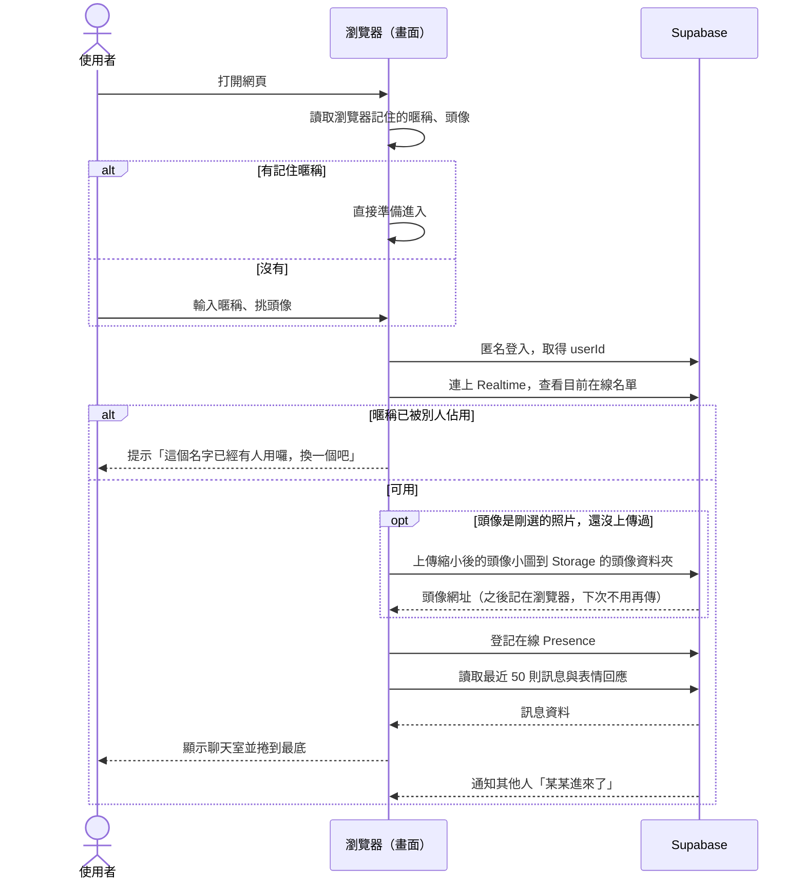

補充說明：

- **暱稱檢查**：進來時先查在線名單。如果兩個人幾乎同時用同一個暱稱，登記後會再比對一次，**後登記的那一位**會被請去換暱稱。
- **同一個人開兩個分頁**：是同一個身分，名單只算一人，用同一個暱稱不算撞名。
- **暱稱比對方式**：去掉前後空白、不分英文大小寫、全形半形視為相同。「系統」「管理員」「admin」「system」這類保留字不能用，避免有人冒充。
- **重新整理不洗版**：重新整理或短暫斷線時，同一個 `userId` 在 5 秒內回來，就**不會**顯示「離開了／進來了」。
- **照片頭像在按下「進入聊天室」、暱稱確認可用之後才上傳**，沒進來的人不會留下沒用的檔案。
- **換頭像**：和換暱稱同一條路，按「換暱稱」回到入口畫面重新選。舊訊息保留當時的頭像，不會跟著變。

### 6.2 送出訊息

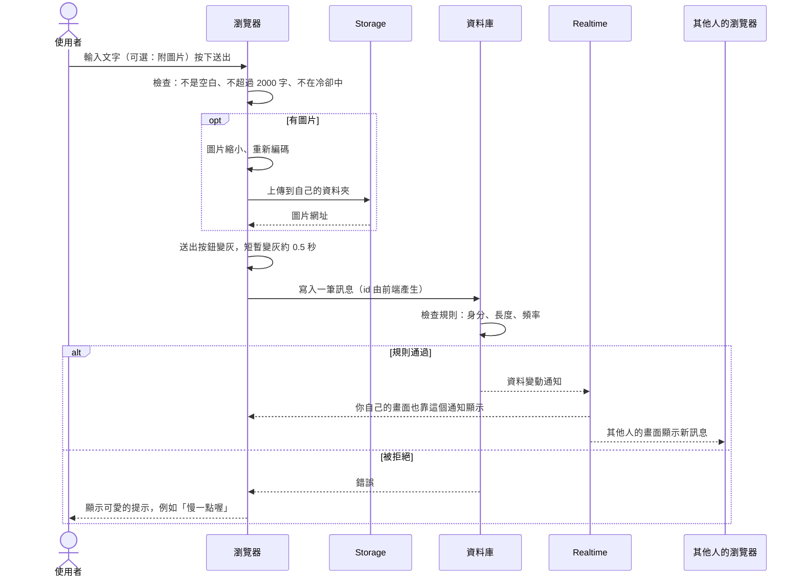

補充說明：

- 前端先檢查是為了讓使用者馬上得到回應，**真正的把關在資料庫**，因為有人可以不透過網頁直接呼叫資料庫。
- 送出後，自己的訊息會先以「傳送中」的樣子顯示，收到通知後轉為正常。失敗則顯示「重送」。
- **收回、復原、按表情**的流程類似：前端呼叫 → 資料庫檢查「是不是你」→ 通知所有人 → 所有人的畫面同步更新。

### 6.3 離開

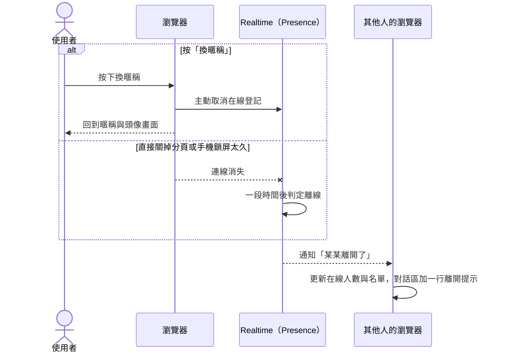

補充說明：

- 關掉分頁時，瀏覽器沒辦法保證能把「我要走了」送出去，所以系統**靠 Presence 自動偵測離線**。這可能有幾秒到幾十秒的延遲，這是正常的。
- 離開後，這個暱稱就釋放，別人可以使用。
- 離開**不會**清掉你之前發的訊息。

### 6.4 斷線重連

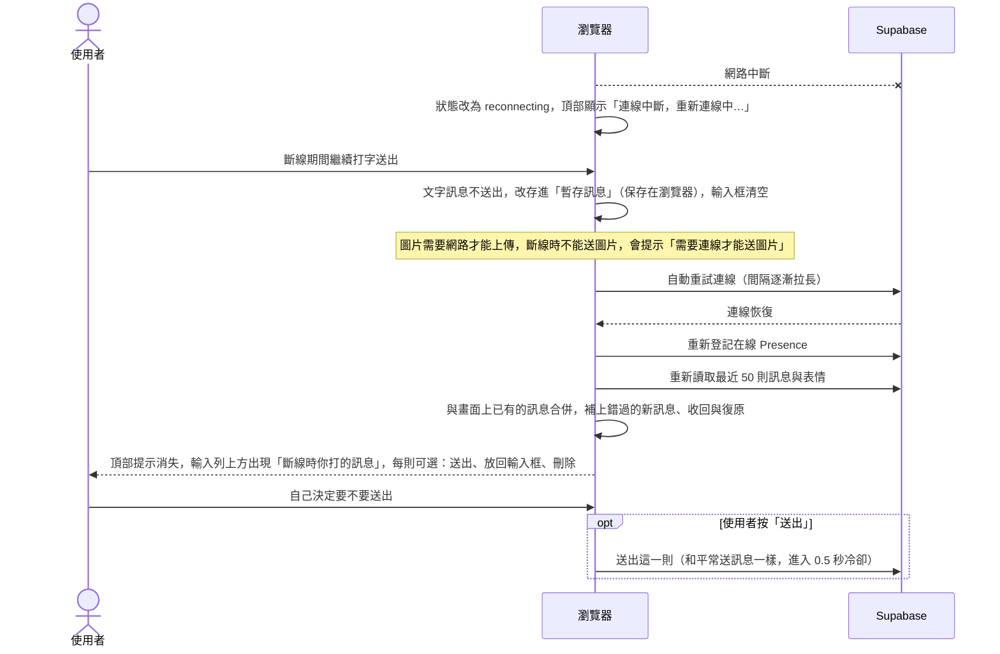

補充說明：

- **不會自動送出**：斷線期間打的話，過了一段時間再送出去，內容可能已經對不上當時的對話，所以改成由你決定。
- **暫存訊息保存在瀏覽器**：連線恢復前就重新整理網頁，暫存的訊息也還在。
- **數量上限**：最多暫存 5 則，超過時提示「暫存已滿，先處理一下之前的訊息吧」。
- **送出時**：和平常送訊息一樣要遵守 0.5 秒冷卻，所以連按幾則「送出」會一則一則出去。
- **放回輸入框**：把那則文字放回輸入框，可以修改後再送。如果輸入框裡已經有字，先提示「輸入框裡已經有內容，要取代嗎？」。
- 每則暫存訊息的 `id` 在輸入時就已產生。如果其實已經送出、只是沒收到回應，之後你按「送出」時資料庫會發現 `id` 重複而略過，**不會出現兩則一樣的訊息**。
- 重新連線時，如果使用者往上翻看舊訊息，**不會被拉到底部**，只在下方的新訊息按鈕上累計數量。
- 重連期間，如果你的暱稱被別人佔用了（你離線太久被判定離開），重連後會請你重新取名。

### 6.5 刪除我的照片

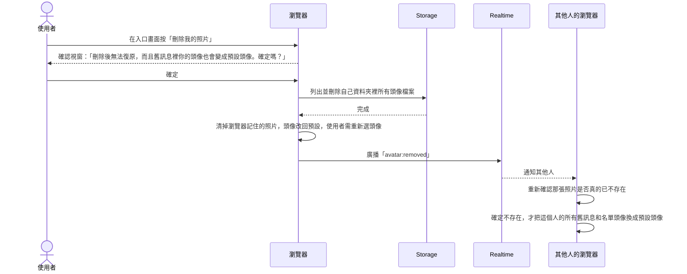

補充說明：

- **誰能刪**：只能刪「這個瀏覽器的匿名身分」上傳的照片。
- **舊訊息都會受影響**：這個人過去所有的訊息，頭像都會變成預設頭像。這是你選擇的行為。
- **其他人的畫面**：在線的人會即時更新。離線的人下次打開時，舊訊息的照片網址已經失效，自然顯示預設頭像。
- **為什麼要「重新確認」**：任何人都有可能偽造「某某刪除了照片」的通知，只為了讓別人的畫面變難看。所以收到通知後，畫面會先重新嘗試載入那張照片，真的載不到才換成預設頭像。
- **圖片快取**：瀏覽器或網路上的快取可能還短暫留著照片，通常幾分鐘到幾小時內會消失。已經被別人存下來的截圖，我們當然收不回來。
- **正在使用的頭像**：如果刪除時你正在聊天室裡，頭像會立即換成預設頭像，在線名單也同步更新。

### 6.6 悄悄話分段（只在「兩個人」）

悄悄話**只有「兩個人」一對一聊天室有**，「好多人」群組沒有這個功能。所以下面的「雙方」就是訪客和 縵。

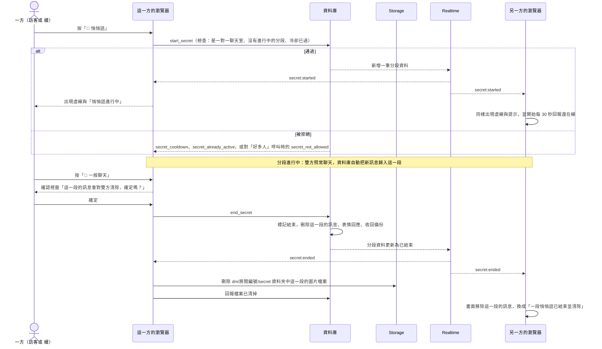

**進入聊天室時剛好有悄悄話進行中**：

- 畫面一進來就顯示虛線與「悄悄話進行中」，並提示「你是在悄悄話進行中進來的，只看得到你進來之後的悄悄話」。
- 載入歷史時只載入一般聊天的訊息，悄悄話則只載入你進來之後的。

**你離開再回來（關分頁、重新整理）**：

- 如果悄悄話還在進行，回來後看到的是新的畫面：離開前的悄悄話看不到，只看得到回來之後的。
- 如果悄悄話在你離開期間已經結束，你看到的是一般歷史加上那一行「一段悄悄話已結束並清除」。

**沒有人按回按鈕、兩個人都離開了**：

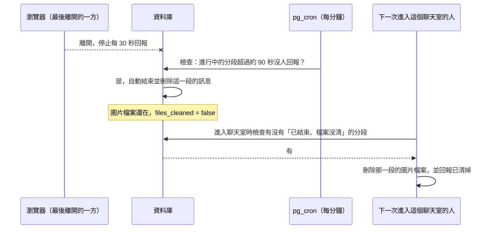

補充說明：

- **兩個人同時按**：資料庫一次只處理一個，先到的成功，後到的收到 `secret_already_active` 或 `secret_not_active`，畫面顯示溫和的說明，不報錯。
- **斷線期間的變化**：重新連線後會重新確認目前有沒有進行中的分段。如果分段在你斷線時結束了，畫面會把這一段的訊息移除；如果在你斷線時開始了，畫面會進入悄悄話狀態。
- **斷線暫存的訊息**：你斷線期間存起來的文字，之後按「送出」時會歸入**當時**的模式（可能是悄悄話，也可能是一般聊天）。送出前畫面會顯示目前的模式，不會悄悄把一般訊息變成悄悄話。
- **進出提示**：「兩個人」只有兩個人，沒有進出提示；「好多人」有進出提示，但沒有悄悄話。
- **縵 的對話列表**：悄悄話進行中，列表上該對話的最後一則訊息預覽顯示「🫧 悄悄話」，不顯示內容。

### 6.7 打開網址：選身分、進入「好多人」或「兩個人」

> **身分規則**：在選身分畫面按「訪客」，這個分頁就一直是訪客（重新整理也是），就算這台裝置有被記得是縵。按「縵」：這台裝置被記得就直接以縵進去，沒被記得才要輸入帳號密碼。

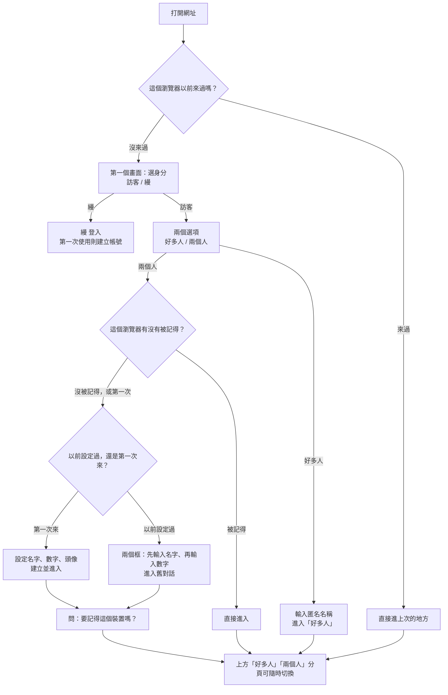

**開新的 「兩個人」聊天室**：

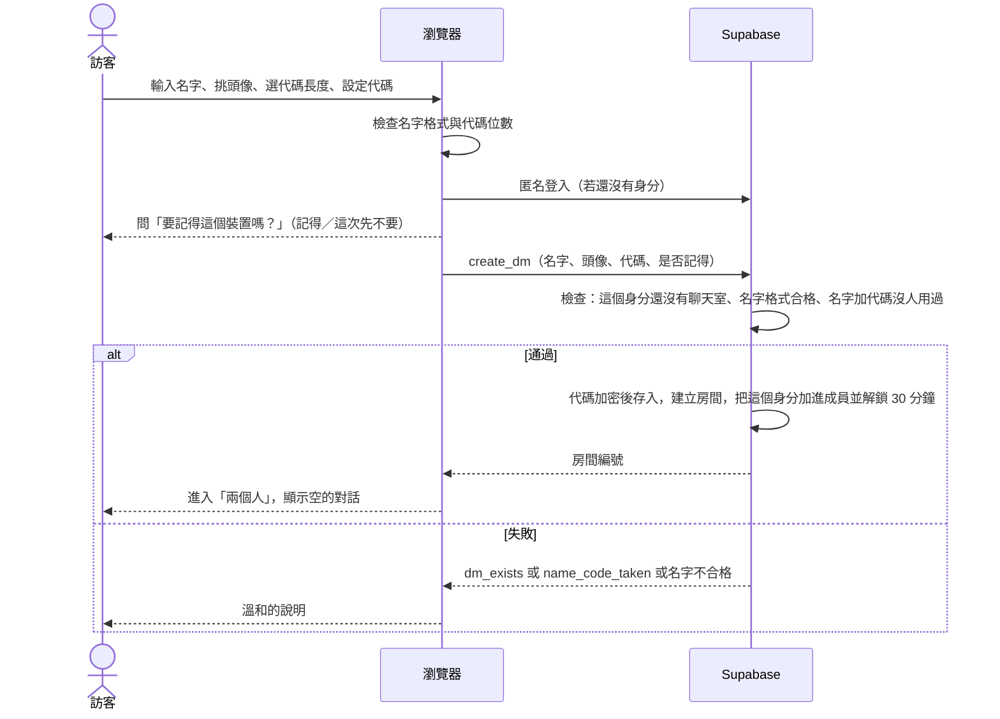

**輸入名字加代碼進入（新裝置接回舊對話，或同一台沒被記得的裝置再次進入）**：

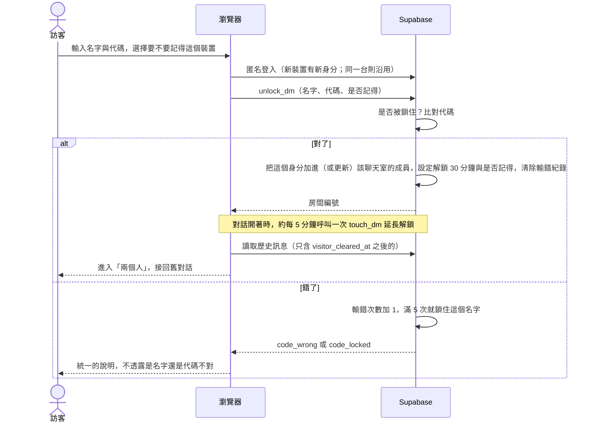

補充說明：

- **清除瀏覽器資料，又忘了代碼**：找不回舊對話，只能重新開一個新的（舊的那個要等 縵 自己處理）。
- **舊裝置**：接回之後，舊裝置仍然可以繼續聊同一個對話（它的「記得」狀態不受影響）。
- **沒被記得的裝置**：離開頁面約 30 分鐘後，資料庫就不再讓這個裝置讀寫對話，下次打開要重新輸入名字加代碼。
- **被記得的裝置**：不用輸入代碼，直接進入；超過 30 天沒用就自動忘記。
- **反悔**：在「兩個人」分頁的選單，隨時能關閉「記得這個裝置」（立刻生效，之後每次都要輸入），或按「忘記我所有的裝置」。
- **同一個匿名身分只能有一個聊天室**：已經開過的瀏覽器，再選「開新的」會被擋，提示「你已經有一個跟 縵 的聊天室了」。

### 6.8 縵 這一側：登入、收訊息、管理對話

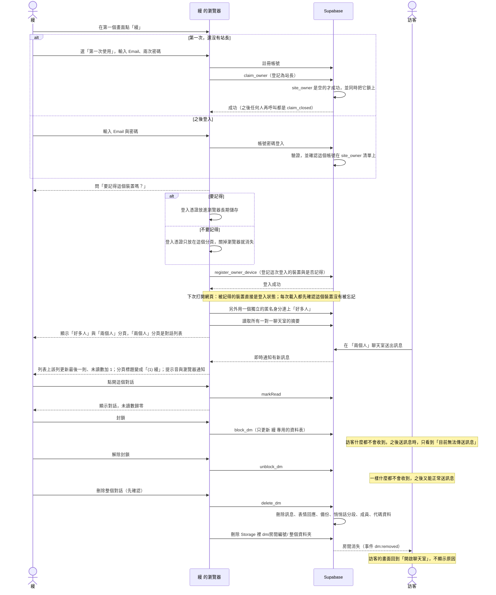

補充說明：

- **兩個連線**：縵 的瀏覽器同時有兩個身分，一個是站長登入（管理一對一聊天室），一個是獨立的匿名身分（用來在「好多人」裡匿名發言）。兩者互不相通，資料庫裡看不出群組裡哪個匿名成員是 縵。
- **忘記某個裝置**：你在「設定」按某個裝置的「忘記此裝置」，資料庫替那一筆裝置紀錄填上時間。那個裝置下一次對資料庫做任何站長才能做的事（例如讀對話列表），就會被拒絕，網站收到 `device_revoked`，立刻回到登入畫面。即時性取決於那個裝置有沒有開著網頁；沒開著就是下次打開時。
- **反悔**：想再記得某個裝置，就在那個裝置上重新登入並選「要記得」。「記得」不是永久的，30 天沒用就自動忘記。
- **首次建立站長有一個空窗期**：從階段二上線，到你第一次登入之間，任何找到網址的人都有機會搶先建立站長帳號。見 9.3。
- **縵 登出**：站長登入的連線結束；「好多人」的匿名身分仍然留在瀏覽器裡，像一般訪客一樣。
- **縵 的開關**：打開「公開我的在線狀態」時，縵 的瀏覽器才會在專用頻道登記在線；關掉時立即取消登記。「公開已讀」同理，關閉時沒有任何資料會送到訪客那邊。
- **通知的限制**：以上所有通知（未讀數、分頁標題、提示音、瀏覽器通知）都**只在 縵 的網頁開著時有效**。

---

## 7. 畫面清單

這一章只描述「有什麼元素、各自的行為」。顏色、字型、動畫風格不在這裡，交給 `/design`。

### 7.1 畫面一覽

| # | 畫面 | 什麼時候出現 |
|---|---|---|
| 0 | 第一個畫面：選身分（訪客 / 縵） | 第一次打開網址，或從選單回到這裡 |
| 0a | 訪客的兩個選項（好多人 / 兩個人） | 在第一個畫面點「訪客」 |
| 0b | 站長登入／建立帳號畫面 | 在第一個畫面點「縵」 |
| 0c | 「要記得這個裝置嗎？」詢問（站長版） | 站長登入或建立帳號成功後 |
| 0d | 「要記得這個裝置嗎？」詢問（訪客版） | 訪客輸入名字加代碼進入「兩個人」成功後 |
| 1 | 「好多人」入口畫面（匿名名稱 + 頭像） | 選了「好多人」，或按「換暱稱」 |
| 1e | 「兩個人」進入畫面（**兩個框：名字、數字**） | 選了「兩個人」，且這台裝置沒被記得時。這是預設會看到的畫面 |
| 1d | 「兩個人」第一次設定畫面（名字 + 數字 + 頭像） | 在進入畫面按「第一次來？設定我的名字和數字」 |
| 10 | 站長：對話列表 | 縵 登入後，點「兩個人」分頁 |
| 11 | 站長：一對一對話畫面 | 在對話列表點某個人 |
| 12 | 站長：設定（兩個公開開關） | 縵 畫面上的設定按鈕 |
| 1b | 頭像相機視窗 | 在入口畫面按「拍照」 |
| 1c | 頭像裁切視窗 | 選好相簿照片或拍完照之後 |
| 2 | 聊天室主畫面 | 進入後的主要畫面 |
| 3 | 在線名單面板 | 點頂部狀態列展開 |
| 4 | 表情回應名單提示（奶茶色，箭頭朝上） | 點一下訊息下方的表情 |
| 5 | Emoji 面板（只有電腦、筆電） | 按輸入框右邊的笑臉 |
| 5b | 表情回應選擇器（放大鏡加分類；按放大鏡才出現搜尋框） | 按訊息下方的「＋」 |
| 6 | 選好圖片後的預覽列 | 按輸入區的黃色圖片按鈕，直接開啟手機／電腦的相簿，選好後出現 |
| 7 | 圖片放大檢視 | 點訊息裡的圖片 |
| 8 | 狀態提示（連線、錯誤、示範模式） | 依情況出現 |
| 9 | 結束悄悄話確認視窗 | 在悄悄話進行中，按「💬 一般聊天」時 |

### 7.2 入口畫面

**第一個畫面：選身分（第一次打開網址）**

| 元素 | 行為 |
|---|---|
| 歡迎標題與可愛插圖位 | 純展示 |
| 選項一：「訪客」 | 大的可點卡片，進入「訪客的兩個選項」。附一句小說明，例如「任何人都可以進來」 |
| 選項二：「縵」 | 大的可點卡片，進入站長登入畫面。附一句小說明，例如「站長入口，需要登入」 |

**訪客的兩個選項（點了「訪客」之後）**

| 元素 | 行為 |
|---|---|
| 選項一：「好多人」 | 大的可點卡片，進入「好多人」入口畫面。附一句小說明，例如「大家一起聊，全部匿名，只要輸入一個名稱」 |
| 選項二：「兩個人」 | 大的可點卡片，進入「兩個人」進入畫面（兩個框：先輸入名字、再輸入數字）；這台裝置已被記得的話則直接進去。附一句小說明，例如「只有你和 縵 兩個人，需要你自己設的數字」 |
| 「回上一頁」 | 回到「選身分」畫面 |

**站長登入畫面**

| 元素 | 行為 |
|---|---|
| Email、密碼輸入框 | 密碼預設遮住，有「顯示」開關 |
| 「登入」按鈕 | 驗證中顯示載入。失敗時統一顯示「帳號或密碼不對」，不透露是哪一個。連續失敗有短暫等待 |
| 「第一次登入」連結 | 在畫面最下面左邊，右邊是「忘記密碼」（見 8.2.3；示範模式點了只顯示說明）。連結一直都在，不管有沒有站長。點了標題變成「建立縵縵帳號」，出現「確認密碼」欄位，按鈕變成「建立站長帳號」，連結變成「回到登入」。帳號是 Email 格式；密碼至少 8 個字元，兩次要一樣，不合格時說明原因。已經有站長時，建立一律失敗，只顯示「無法建立站長帳號」，不透露原因 |
| 「記得這個裝置」詢問 | 登入或建立帳號成功後，立刻問：「要記得這個裝置嗎？下次不用再輸入密碼。之後可以在設定裡更改」。兩個按鈕：「記得」「這次先不要」 |
| 「忘記密碼」提示 | 登入畫面下方一行小字：「忘記密碼？到 Supabase 後台的使用者頁面幫這個帳號重設密碼」。沒有寄信功能 |
| 「回上一頁」 | 回到「選身分」畫面 |

**「好多人」入口畫面**

| 元素 | 行為 |
|---|---|
| 歡迎標題與可愛插圖位 | 純展示 |
| 匿名名稱輸入框 | **只要輸入這個就能進去**。即時顯示字數（x/20）。有記住的名稱時預先填入。接受中文、英文、數字、emoji 與空格；輸入不接受的符號時，立刻說明「只能用文字、數字和 emoji」 |
| 頭像選擇列 | 一排內建頭像，每個放大，一排剛好看到 5 個，點選其中一個，被選的有明顯標記。預設選第一個，可以橫向捲動 |
| 「看全部小動物」按鈕 | 在「相簿」「拍照」右邊，樣式和它們一樣的白底按鈕，小豬臉圖示（只有兩顆眼睛和豬鼻子）加「全部小動物」。按下去開啟整頁「所有可選的小動物」，一排 3 個、附名字，目前選的有標記，點一隻就選它並回到原畫面 |
| 「相簿」按鈕 | 開啟裝置的相簿或檔案選擇。接受 JPG、PNG、WebP，原檔最大 10 MB（手機照片通常比較大，之後會自動縮小）。選好後進入「頭像裁切視窗」 |
| 「拍照」按鈕 | 開啟「頭像相機視窗」。手機上用相機，電腦上用視訊鏡頭。瀏覽器會先問是否允許使用相機 |
| 目前頭像預覽 | 顯示即將使用的頭像（內建或照片）。選了照片後，旁邊出現「改回內建頭像」 |
| 「刪除我的照片」按鈕 | 只有曾經上傳過照片頭像（這個瀏覽器記得有上傳過）時才顯示。按下後出現確認視窗，說明「刪除後無法復原，而且舊訊息裡你的頭像也會變成預設頭像」。確定後刪除所有上傳過的照片，頭像改回預設，並顯示「照片已刪除」 |
| 「進入聊天室」按鈕 | 暱稱不合格（空白、超過 20 字、保留字）時不可按，並說明原因。按下後顯示載入中 |
| 錯誤提示 | 撞名時顯示「這個名字已經有人用囉，換一個吧」，輸入框保留內容讓使用者修改 |

**「兩個人」第一次設定畫面（開新的聊天室）**

| 元素 | 行為 |
|---|---|
| 標題 | 例如「只跟 縵 聊」 |
| 名字輸入框 | 欄位旁有小標語「輸入自己的名字」。字數 x/20，規則和群組暱稱一樣，**可以和別人重複**。「縵」等保留字不能用 |
| 頭像選擇 | 和「好多人」入口畫面相同（內建頭像、相簿、相機、頭像預覽、刪除我的照片），另外多一個「沿用群組的頭像」按鈕。進到 縵 之後，隨時能再改 |
| 代碼長度選擇 | 「四位數」「六位數」二選一，預設四位數。選六位數時旁邊提示「比較不容易被猜到」 |
| 代碼輸入框 | 只接受數字，位數不足時不可送出。提示文字：「這組代碼用來日後換手機或清除資料後，找回你跟 縵 的對話。請選一組你記得住、別人猜不到的數字，不建議用生日」。輸入時預設遮住，有「顯示」開關 |
| 代碼說明 | 一行小字：「忘記代碼又換了裝置，就找不回這個對話了」 |
| 「開始聊天」按鈕 | 名字或代碼不合格時不可按，並說明原因。按下後顯示載入中 |
| 「我已經設定過了」連結 | 回到「進入畫面」（兩個框：名字、數字） |
| 「要記得這個裝置嗎？」詢問 | 按「開始聊天」且成功建立後，立刻問：「要記得這個裝置嗎？記得之後，這台裝置進『兩個人』不用再輸入數字。之後可以在選單更改」。兩個按鈕：「記得」「這次先不要」。預設沒回答前不記得 |
| 錯誤提示 | `dm_exists`：「你已經有一個跟 縵 的聊天室了」並提供直接進入的按鈕；`name_code_taken`：「這組代碼已經有人用了，換一組吧」 |

**「兩個人」進入畫面（預設會看到的畫面：兩個框，先名字、再數字）**

名字用來找出是哪個對話，數字當密碼。換裝置、清除資料、或這台裝置沒被記得時，都是這個畫面。

| 元素 | 行為 |
|---|---|
| 第一個框：名字 | 小標語「輸入自己的名字」。要和當時設定的一樣。這台裝置有記住名字時預先填入 |
| 第二個框：數字 | 輸入自己預設的數字，位數不限制為 4 或 6，由系統判斷。預設遮住，有「顯示」開關 |
| 「要記得這個裝置嗎？」選擇 | 輸入欄下方有一個核取：「記得這個裝置（下次免輸入代碼）」，預設不勾 |
| 「進入」按鈕 | 成功就進入「兩個人」並顯示舊對話；失敗統一顯示「名字或代碼不對」；鎖住時顯示「輸入錯誤太多次，請晚一點再試」 |
| 「第一次來？設定我的名字和數字」連結 | 切到「第一次設定畫面」 |

### 7.3 聊天室主畫面

由上到下分五塊：分頁列（好多人／縵）、頂部狀態列、（可展開的）在線名單、訊息對話區、底部輸入區。

**分頁列**

| 元素 | 行為 |
|---|---|
| 「好多人」分頁 | 切到匿名多人群組 |
| 「兩個人」分頁 | 切到一對一聊天室。還沒開啟過聊天室時，顯示「兩個人」進入畫面（兩個框：名字、數字） |
| 未讀提示 | 在目前沒開的那個分頁上，有新訊息時顯示一個小圓點，不顯示內容 |
| 選單（⋯） | 「回到選身分畫面」「設定」。在 「兩個人」分頁時，另有「清空我這邊的畫面」「記得這個裝置」開關、「忘記我所有的裝置」 |

**頂部狀態列（「好多人」）**

| 元素 | 行為 |
|---|---|
| 聊天室名稱 | 顯示「好多人」 |
| 在線人數 | 例如「🟢 12 人在線」，隨 Presence 即時更新 |
| 展開／摺疊箭頭 | 點狀態列的人數區域，展開或收起在線名單。預設收起 |
| 太陽／流星按鈕（只在「兩個人」） | 在標題列右邊。太陽＝一般聊天，流星＝悄悄話；目前的模式有明顯標記，另一個變淡。「好多人」沒有這兩個按鈕。切到流星立刻開始悄悄話，切回太陽要先經過確認視窗（見悄悄話說明） |
| 「換暱稱」按鈕 | 先離開聊天室，再回到「好多人」入口畫面 |

**頂部狀態列（「兩個人」一對一聊天室）**

| 元素 | 行為 |
|---|---|
| 聊天室名稱 | 顯示「兩個人」與 縵 的頭像 |
| 縵 的在線狀態 | 只有 縵 公開了才顯示（「縵 在線上」或「縵 目前不在線」）；沒公開時整塊不出現，也沒有任何暗示 |
| 「已讀」標記 | 只有 縵 公開已讀，才會在訊息旁顯示「已讀」，沒公開時不顯示 |
| 沒有在線名單 | 這裡只有兩個人，不需要名單 |
| 「換暱稱與頭像」 | 標題列沒有「換名字」按鈕，改放在選單（⋯）第一項。「兩個人」：只換縵看到的名字和頭像，**登入用的名字和數字不變**（進入畫面仍輸入原本的名字）。「好多人」：離開再回到入口畫面重新選。**整頁**（跟「好多人」入口畫面一樣，不是小視窗）。縵的選單也有這一項：在一對一對話裡，縵可以改自己顯示的名字和頭像，頭像清單的第一個是「縵縵限定」蝴蝶結小兔子（只有縵選得到），預設是「縵」加蝴蝶結小兔子；訪客看到的標題列頭像、縵發的新訊息都跟著變。縵在「好多人」的匿名暱稱與頭像，仍然在「好多人」分頁的選單換。已經送出的舊訊息不會跟著變 |
| 被封鎖時 | 完全沒有任何變化，直到訪客嘗試送出，才顯示「目前無法傳送訊息」 |
| 連線狀態條 | 平時隱藏。斷線時顯示「連線中斷，重新連線中…」，若有暫存訊息則顯示數量 |

**在線名單面板**

| 元素 | 行為 |
|---|---|
| 每人一列 | 頭像 + 暱稱 |
| 自己那一列 | 標示「（我）」，固定在最上面 |
| 其他人 | 依進來先後排列 |
| 同一人開多分頁 | 只算一列 |

**訊息對話區**

| 元素 | 行為 |
|---|---|
| 訊息列表 | 由舊到新，往下是最新。每則包含：頭像、暱稱、時間、內容 |
| 自己的訊息與別人的訊息 | 要能一眼分辨（例如靠左或靠右）。具體樣式交給 `/design` |
| 時間 | 顯示「時:分」，跨日時插入日期分隔 |
| 文字內容 | 一律當成純文字顯示（不會執行任何網頁語法）。**例外：以 `http://` 或 `https://` 開頭的網址會變成可以直接點的連結**，點了在新分頁開啟（`rel="noopener noreferrer nofollow"`）；`javascript:` 這類其他開頭的不會變成連結；不做網址預覽圖 |
| 圖片 | 在訊息內以縮圖顯示（多張時排成格子），點一下進入「圖片放大檢視」，放大檢視的背景是模糊的聊天室。載入失敗時顯示替代圖示與「圖片無法顯示」。文字與圖片可以同時出現在同一則訊息 |
| 表情回應列 | 在每則訊息下方，把大家按過的 emoji 疊在一起顯示，沒有數字。最後面有一個「＋」按鈕，開啟「表情回應選擇器」。點「＋」選一個 emoji：沒按過就是按，點自己目前選的就是取消，點別的就是改選（自己只會有一個被標記）。自己選的有明顯標記。點一下已有的表情，會冒出奶茶色小提示框（箭頭朝上）列出按的人暱稱 |
| 長按自己的訊息 | 跳出小選單：「收回」「設為公告」。長按別人的訊息只有「設為公告」。收回時直接收回，不再另外確認（因為隨時能復原） |
| 已收回的訊息 | 原位置變成置中的小字「收回」（樣子像進出提示）。**自己**長按這個小字會跳出「復原」；別人看不到內容，也看不到表情回應 |
| 刪除（只有我這邊） | 長按任何一則訊息，選單裡有「刪除（只有我這邊）」；長按「🫧 一段悄悄話已結束並清除」那行小字，也有「刪除」。**別人不會知道**你刪了。刪除後原位置留下一個小字「這邊刪除過」（像收回一樣）。輕點或長按這個小字，有「復原」和「直接刪除」兩個選項。**留下的痕跡過了 1 天就完全消失，不能再復原**。這個刪除不影響對方，也不影響縵那邊 |
| 刪除公告 | 在公告紀錄裡，長按某一則，或把它往左滑，出現「刪除」。刪掉的只是公告紀錄，原本的訊息還在；訊息的圖片等檔案從此照一般規則過期 |
| 公告小花 | 在分頁列下方、浮在訊息上，可左右拖動。點了開啟公告列表；列表每一則顯示發話者、內容、原訊息時間與設為公告時間，點一則跳回原位。「設為公告」按鈕上的小花有淺棕色描邊 |
| 進出提示 | 置中的小字，例如「🌸 小米 進來了」「🍃 小米 離開了」。不能被收回，也不能被按表情 |
| 悄悄話分段（進行中，**只在「兩個人」**） | 悄悄話開始的位置有一條虛線，上面寫「🫧 悄悄話開始」；分段裡的訊息整段用虛線框起來，和一般訊息一眼就能分辨。具體樣式交給 `/design` |
| 悄悄話提示條（**只在「兩個人」**） | 悄悄話進行中，固定顯示在訊息區上方：「🫧 悄悄話進行中：按回一般聊天，或兩個人都離開，這一段就會消失」。中途進來的人另外看到一行說明，告訴他只看得到進來之後的悄悄話 |
| 悄悄話結束的標記（**只在「兩個人」**） | 分段結束後，原位置只剩一行置中灰字「🫧 一段悄悄話已結束並清除」，沒有任何細節（不寫時間、則數、是誰按的）。往上翻歷史時，也會在每一段曾經存在的位置看到這一行 |
| 載入更早訊息 | 捲到最頂端時自動載入前 50 則，載入中顯示小動畫；沒有更早的了就顯示「已經到最早囉」 |
| 新訊息按鈕 | 在使用者離開底部時，有新訊息進來，下方出現「↓ N 則新訊息」，點了捲到最底並消失。使用者原本就在底部時則自動捲動 |
| 空狀態 | 還沒有任何訊息時留白，不放邀請文字 |

**底部輸入區**

| 元素 | 行為 |
|---|---|
| 模式切換按鈕（兩個一組） | **只在「兩個人」才有**（「好多人」沒有這兩個按鈕，只有一般聊天）。位於標題列右邊，用太陽（💬 一般聊天）和流星（🫧 悄悄話）兩顆小按鈕代替文字，目前的模式有明顯標記。按「🫧 悄悄話」立刻開始，雙方一起進入；按「💬 一般聊天」先跳出確認視窗。切換後有幾秒冷卻，期間兩個按鈕變灰並顯示倒數。雙方看到的模式一致 |
| 悄悄話模式的輸入提醒 | 悄悄話進行中，輸入框上方多一行小字「現在是悄悄話」。 |
| Emoji 按鈕 | 輸入框右邊的淡紫色小笑臉。電腦開關 Emoji 面板；手機改用手機鍵盤的 Emoji |
| 圖片按鈕 | 黃色圓形。直接開啟裝置的相簿（像 LINE，不跳出自訂視窗） |
| 已附圖片預覽 | 選好照片後，輸入框上方出現黃色的縮圖列：「已選 N 張照片（最多 10 張）」，每張可單獨取消，還有「＋」再加、「全部取消」 |
| 訊息輸入框 | 可輸入多行，超過 2000 字不能再輸入。接近上限時顯示剩餘字數。電腦上按 Enter 送出、Shift+Enter 換行；手機上 Enter 為換行，由送出按鈕送出 |
| 送出按鈕 | 輸入框空白且沒有附圖時不可按。送出後按鈕短暫變灰約 0.5 秒（太短，不顯示數字），之後恢復。斷線時不能送圖片；文字按下去不會送出，而是存進暫存訊息，並提示「目前沒有網路，已先幫你存起來」 |
| 暫存訊息列 | 平時隱藏。有暫存訊息時，出現在輸入框上方：每則顯示文字內容與暫存時間，並有三個動作：「送出」「放回輸入框」「刪除」。斷線中「送出」不可按，連線恢復後才可按。最多 5 則 |
| 錯誤提示 | 在輸入區上方短暫顯示，例如「慢一點喔～」 |

### 7.4 在線名單面板之外的其他小視窗

**結束悄悄話確認視窗**：

| 元素 | 行為 |
|---|---|
| 說明文字 | 「結束後，這一段悄悄話的所有訊息和圖片會對雙方清除，無法復原。確定要結束嗎？」 |
| 「確定結束」 | 結束悄悄話，雙方的畫面清除這一段 |
| 「再聊一下」 | 關閉視窗，繼續悄悄話 |

**表情回應名單提示**：點一下表情後，在表情列下方冒出奶茶色小提示框，箭頭朝上指著表情，列出按了該表情的暱稱，人多時顯示前幾位與「…等 N 人」。

**頭像相機視窗**：

| 元素 | 行為 |
|---|---|
| 即時預覽 | 顯示相機畫面。手機預設用前鏡頭，畫面左右鏡像，像照鏡子 |
| 「拍照」按鈕 | 拍下當下畫面，進入「頭像裁切視窗」 |
| 「切換鏡頭」 | 手機有多個鏡頭時才出現 |
| 「取消」 | 關閉相機並回到入口畫面。**關閉視窗時一定會把相機關掉**，不會偷偷繼續開著 |
| 沒有權限或沒有相機 | 顯示說明（例如「你沒有允許使用相機，可以改用相簿」）。網頁不能直接幫使用者打開瀏覽器的權限設定，所以畫面用三個步驟說明（點網址列的鎖頭 → 相機改成允許 → 回來），並提供「再試一次」按鈕；並提供「改用相簿」按鈕 |

**頭像裁切視窗**：

| 元素 | 行為 |
|---|---|
| 照片預覽加圓形或方形取景框 | 取景框內就是最後的頭像 |
| 拖曳與縮放 | 手機用手指拖曳、兩指縮放；電腦用滑鼠拖曳、滾輪或滑桿縮放 |
| 「使用這張」 | 確認，回到入口畫面並顯示新頭像 |
| 「重選」 | 回到相簿或相機重新選 |
| 錯誤 | 圖片無法讀取（例如格式不支援）時顯示原因 |

技術上，照片會被裁成正方形後縮小到約 256 × 256 像素，重新編碼成小檔案（約幾十 KB）。這個過程一併會移除照片裡的拍攝位置等資料。

**表情回應選擇器**（按訊息下方的「＋」）：

| 元素 | 行為 |
|---|---|
| 分類頁籤 | 例如表情、動物、食物、活動、物品、符號，點了跳到該分類 |
| 放大鏡 | 預設只顯示放大鏡，和分類頁籤排在同一排；按了才出現搜尋輸入框，輸入中文或英文關鍵字，例如「愛心」「cat」，即時篩出相符的 emoji |
| 最近使用 | 顯示自己最近選過的 emoji，記在瀏覽器 |
| 點一個 emoji | 套用為你對這則訊息的表情回應（沒按過就是按，已有別的就是改選），選擇器自動關閉 |
| 關閉 | 點外面或按 Esc |

emoji 清單是我們自己整理成一個資料檔放進 repo（含分類和中英文關鍵字），不依賴外部服務。為了避免舊手機把新 emoji 顯示成方框，清單只收錄大多數裝置都已支援的版本。

**Emoji 面板**（輸入區用的）：
- 彈出在輸入區上方，約 30 個常用可愛 Emoji。
- 點一個就插入輸入框游標位置，面板自動關閉，焦點回到輸入框。
- 點面板外面也會關閉。

**選圖片**：沒有自訂視窗。按黃色圖片按鈕，直接開啟裝置的相簿（手機是系統相簿，電腦是檔案選擇器），不離開網站。接受 JPG、PNG、GIF、WebP，上限 2MB；選好後圖片進入輸入區預覽（縮圖與 ✕ 取消）。太大或格式不對時，用提示條說明原因。不支援貼圖片網址，網址直接打在輸入框當文字。

**圖片與影片放大檢視**：圖片或影片置中放大，背景是模糊的聊天室。點外面、按 ✕、或按 Esc 關閉。**右下角有「儲存」按鈕**，把這張圖片或這支影片存到自己的裝置（過期的檔案沒有）。

**狀態提示**：

- 示範模式提示條（階段一）。
- 連線狀態條（見上）。
- 短暫浮出的錯誤或成功提示（奶茶色小提示），約 2 秒後自動消失；**按畫面上任何其他地方會馬上消失**。

### 7.5 不同螢幕大小

| 裝置 | 版面行為 |
|---|---|
| 手機（窄） | 單欄，輸入區貼在底部。在線名單從頂部展開，覆蓋在訊息上方。輸入區要避開手機的虛擬鍵盤與瀏覽器底部列 |
| 平板 | 單欄置中，兩側留白，字與按鈕稍大 |
| 電腦（寬） | 聊天室置中成一個固定最大寬度的區塊，不要讓訊息拉到全螢幕那麼寬 |

**電腦版的兩欄（好多人的在線名單、縵的對話列表）**：

- 視窗夠寬時，左邊有一欄，聊天室在右邊。每一欄都有一顆小箭頭，按了可以收起，收起後縮成一條窄窄的欄，只留一顆按鈕可以再展開，聊天室就占滿整個寬度。
- 視窗寬度**約 900 像素以下**時，兩欄**自動收起**，版面變得跟手機一樣是單欄。窄到收起之後，仍然可以用那顆小按鈕把它叫出來，蓋在聊天室上方。
- 使用者縮小視窗、或把瀏覽器和其他視窗並排時，版面會即時跟著調整，不需要重新整理；任何寬度都不會出現左右捲動。
- 設計稿只畫了手機（390 寬）與電腦（1180 寬）兩種尺寸，中間尺寸以這一段的規則為準。
- 電腦版的分頁列最左邊同樣有展開箭頭，預設收起標題列，讓聊天區變大。

所有按鈕要大到手指好點（觸控目標至少約 44 像素見方）。

### 7.6 站長（縵）的畫面

縵 登入後，上方是「好多人」「兩個人」兩個分頁。「好多人」和訪客看到的完全一樣（用匿名暱稱）。「兩個人」分頁是下面這些。

**對話列表（畫面 10）**

| 元素 | 行為 |
|---|---|
| 列表 | 每個一對一聊天室一列：頭像、名字、最後一則訊息的前幾個字（圖片顯示「📷 圖片」；悄悄話顯示「🫧 悄悄話」，**不顯示內容**）、時間、未讀數。最新有訊息的排最上面 |
| 未讀數 | 該對話中、你還沒看過的訪客訊息數。已讀為 0 時不顯示 |
| 被封鎖的對話 | 列上有小標記「已封鎖」，只有你看得到 |
| 搜尋框 | 依名字篩選列表 |
| 長按或往右滑 | 長按某個人，或把他那一列往右滑，會出現四個選項：**置頂**（或取消置頂）、**靜音**（或取消靜音）、**封鎖**（或解除封鎖）、**刪除這個人和他的訊息**（會先跳出確認視窗，確定後整個對話真的刪掉）。往右滑露出的按鈕只有圖案，沒有文字（長按的選單有文字）。**已封鎖的對話一律排在列表最下面**，就算它有置頂也一樣。靜音的對話：沒有提示音、沒有瀏覽器通知、不算進分頁標題的未讀數（列表上的未讀數字還是有，顏色變灰）；列上有小鈴鐺劃掉的圖示。手機用手指滑，電腦用滑鼠拖 |
| 空狀態 | 還沒有人傳訊息給你時，列表留白，不放任何提示文字 |
| 點某一列 | 打開那個人的一對一對話（畫面 11） |
| 瀏覽器分頁標題 | 有未讀時顯示「(N) 縵」，N 是所有對話的未讀總數 |
| 提示音與通知 | 有新訊息時播放提示音（可在設定關閉），並在使用者允許時彈出瀏覽器通知（只顯示名字，不顯示訊息內容，避免被旁邊的人看到）。**只在網頁開著時有效** |

**一對一對話畫面（畫面 11）**

| 元素 | 行為 |
|---|---|
| 返回 | 回到對話列表（手機上是返回；電腦寬度則是左邊列表、右邊對話並排） |
| 對方資料 | 名字與頭像 |
| 訊息區、輸入區、表情回應、收回與復原 | 和「好多人」相同。你發的訊息以你設定的名字與頭像顯示（預設是「縵」和蝴蝶結小兔子，可以在選單的「換暱稱與頭像」改） |
| 悄悄話 | **只有這裡有**：標題列右邊有太陽（一般聊天）、流星（悄悄話）兩顆按鈕，你和訪客任何一方都能開始與結束 |
| 選單（⋯） | 「封鎖」或「解除封鎖」（看目前狀態）、「刪除整個對話」 |
| 封鎖 | 按下去立即生效，不會通知對方。列表上該對話出現「已封鎖」標記 |
| 解除封鎖 | 按下去立即生效，不會通知對方 |
| 刪除整個對話 | 先跳出確認視窗：「刪除後，這個人的訊息、圖片和這個對話都會真的刪掉，無法復原。對方不會收到通知，但他的畫面會回到『開啟聊天室』。確定嗎？」確定後才刪 |
| 打開對話時 | 自動把這個對話標記為已讀（未讀數歸零） |
| 看不到的東西 | 你**看不到**訪客的在線狀態和已讀，也看不到訪客是不是被你封鎖後還在試著傳訊息 |

**設定（畫面 12）**

| 元素 | 行為 |
|---|---|
| 「公開我的在線狀態」開關 | 預設**關**。打開後，訪客會在 「兩個人」分頁看到「縵 在線上／不在線」。關掉後立即停止公開 |
| 「公開已讀」開關 | 預設**關**。打開後，訪客會看到你已讀到哪裡。關掉後立即停止公開 |
| 「提示音」開關 | 預設開，只影響你自己 |
| 「瀏覽器通知」 | 第一次按會請瀏覽器要權限；拒絕了就顯示說明如何重新允許 |
| 「記得這個裝置」開關 | 針對**目前這台**裝置。打開後，下次免輸入密碼；關閉後，關掉瀏覽器就登出 |
| 「已登入的裝置」清單 | 每個裝置一列：名稱（例如「Chrome · Windows」）、最近使用時間、是否被記得、標示「這台」。除了這台，每一列有「忘記此裝置」按鈕，按了先確認，確定後那個裝置立刻失去站長權限 |
| 「登出所有其他裝置」 | 一鍵忘記除了這台以外的所有裝置，先確認 |
| 登出 | 登出站長身分，回到訪客畫面。登出後這個裝置的登入紀錄一併作廢（要再登入須輸入密碼） |

---

## 8. 金鑰

**金鑰**（API key）可以想成「進入某個服務的通行證」。它決定誰能對你的 Supabase 做什麼事。

### 8.1 這個專案會碰到的金鑰與憑證

| 名稱 | 是什麼 | 可以公開嗎 | 這個專案用不用 |
|---|---|---|---|
| **Project URL** | 你的 Supabase 專案網址，長得像 `https://xxxx.supabase.co` | 可以 | 用 |
| **Publishable key**（舊版叫 anon key） | 給網頁用的「受限通行證」。拿到它的人，只能做 RLS 規則允許的事 | **可以**，它本來就一定會出現在網頁裡 | 用 |
| **Secret key**（舊版叫 service_role key） | 「萬用通行證」，**會繞過所有 RLS 規則**，等於資料庫完全開放 | **絕對不行** | **不用，也不會產生或放進專案** |
| **資料庫密碼** | 建立 Supabase 專案時設定的密碼，可以直接連資料庫 | **絕對不行** | 不用，你只需要自己保管好 |
| **Supabase 帳號登入資料** | 你登入 Supabase 後台的帳號密碼 | **絕對不行** | 不屬於專案，自己保管，建議開兩步驟驗證 |
| **站長（縵）帳號的 Email 與密碼** | 你登入聊天室（第一個畫面的「縵」）用的帳號密碼，由你在網站上第一次登入時建立 | **絕對不行**。這是這個專案**最重要的秘密**：拿到它的人就能讀到所有訪客跟你的私人對話 | 用，但只存在你的密碼管理工具，**不寫進任何檔案、不貼進聊天**。密碼至少 8 個字元；建議用更長且隨機的密碼，並開啟兩步驟驗證 |
| **訪客的代碼** | 訪客自己設定的四位或六位數字 | 不是專案的金鑰，是訪客的個人資料 | 資料庫只存加密後的結果，連 縵 也看不到明文 |
| **GitHub 帳號與 Token** | 你登入 GitHub 或讓程式推送用的憑證 | **絕對不行** | 不屬於專案 |

> 為什麼 Publishable key 公開沒關係：就像大樓大門的門牌號碼，大家看得到沒關係，重要的是每個房間（資料表）有沒有上鎖（RLS）。**所以只要 RLS 沒設好，公開的 Publishable key 就會變成大洞**，這也是為什麼第 5.4 節的規則要一次設定完整。

### 8.2 怎麼產生

1. 到 supabase.com，用你的帳號建立一個新專案。建立時會要你設定**資料庫密碼**，請用密碼管理工具產生並保存，不要貼到任何檔案或聊天裡。
2. 專案建好後，到後台的「Project Settings → API Keys」（或「API」）頁面。
3. 複製 **Project URL** 和 **Publishable key**（舊版介面顯示為 `anon` `public`）。
4. **不要複製 Secret key / service_role key**。這個專案用不到它。
5. 資料表、規則、Storage 的建立，用後台的「SQL Editor」貼上我們準備好的 SQL 腳本執行。這個過程用你已登入的後台，**不需要任何 Secret key**。
6. 在後台的「Authentication → Sign In / Providers」開啟「Allow anonymous sign-ins」（允許匿名登入）。
7. 在後台的「Authentication → Sign In / Providers → Email」：保持 Email 登入**開啟**，把「**Confirm email**（寄驗證信）」**關閉**。這樣網站上註冊後可以直接登入，不需要寄信。
   - **密碼長度**：規則是「**至少 8 個字元**」。Supabase 有一個「最低密碼長度」設定（預設約 6 個字元，在同一個頁面或 Authentication 的密碼設定裡），請把它改成 8，網站畫面也會同樣檢查。Supabase 有上限（密碼最多約 72 個字元）。
   - **帳號**：就是 Email，一定要是 Email 的樣子（例如 `名字@網域`）。因為這個專案不寄信，所以**不必是真的信箱**，但仍建議用你自己看得到的信箱，萬一之後想改用別的流程比較方便。
8. **不需要**在後台手動建立站長帳號，也**不需要**貼任何登記站長的 SQL。站長帳號在網站上建立（見 8.2.1）。
9. 帳號建好之後，建議到後台開啟這個帳號的兩步驟驗證（MFA）。
10. 如果日後忘記站長密碼：到後台的「Authentication → Users」找到這個帳號，直接設定新密碼。

#### 8.2.1 第一次建立站長帳號（階段二上線後）

1. 準備好帳號（Email 格式）與密碼（至少 8 個字元）。建議用密碼管理工具產生一組更長且隨機的密碼。
2. 階段二上線**之後，立刻**打開網站，在第一個畫面點「縵」→ 最下面的「第一次登入」，輸入 Email 與密碼。
3. 成功後會問你「要記得這個裝置嗎？」，由你決定。
4. 到「設定」確認「已登入的裝置」清單裡有這一台。
5. **盡快、最好在公開網址之前完成**：在你建好帳號之前，任何找到網址的人都能搶先建立。越晚做，風險越高（見 9.3）。
6. 之後換手機、換電腦時，用同一組 Email 與密碼登入即可。

#### 8.2.2 快速登入（階段二上線時加入）

建好帳號、問「要記得這個裝置嗎？」之後，再問「要設定快速登入嗎？」，兩種可以擇一或都設：

| 方式 | 做法 | 注意 |
|---|---|---|
| **Face ID／指紋** | 用瀏覽器內建的 WebAuthn（通行金鑰 passkey），手機和筆電的生物辨識都能用 | 需要 https（GitHub Pages 本來就是）。生物辨識資料留在裝置裡，網站拿不到。Supabase 目前沒有內建這個登入，要另外用 Edge Function 驗證，做之前再評估；做不到時退回「記得此裝置」＋ 裝置本身的解鎖 |
| **6 位數字** | 只在「已記得的裝置」上，用 6 位數字取代每次輸入密碼 | 6 位數有一百萬種，比 4 位數安全很多，但還是**不能單獨當登入**：只能解鎖這台已記得的裝置，連續輸錯 5 次就鎖住，要改輸 Email 與密碼；換新裝置一定要用 Email 與密碼 |

規則：快速登入只是「這台裝置的捷徑」，Email 與密碼永遠是根本的登入方式；在「設定 → 已登入的裝置」可以關掉某台裝置的快速登入；登出或移除裝置時一併作廢。階段一示範模式不做。

#### 8.2.3 忘記密碼（階段二上線時加入）

1. 縵的登入畫面放「忘記密碼」。輸入當初設定的 Email，系統寄一封重設連結過去，點進去就能設新密碼（用 Supabase 內建的重設功能）。
2. 重設成功後，所有已記得的裝置都登出，快速登入（Face ID／指紋、6 位數字）一併作廢，登入後重新設定。
3. 忘記 6 位數字不用救援：輸錯 5 次鎖住後改用 Email 與密碼登入，再設新的一組。
4. 不論信箱有沒有這個帳號，畫面都顯示「如果這個 Email 有註冊，已經寄出重設信」，避免被人試探哪個 Email 是站長。
5. Email 要填自己長期會用的信箱，並建議替信箱本身開雙重驗證（誰進得了信箱，誰就能重設站長密碼）。階段一示範模式不做。

### 8.3 放在哪裡

| 憑證 | 放哪裡 |
|---|---|
| Project URL、Publishable key | 放在前端的 `js/config.js`，**會提交到 GitHub**，也會公開在網頁上 |
| 其他所有東西 | **不放進專案**。資料庫密碼、Supabase/GitHub 帳號資料只存在你的密碼管理工具 |

因為 GitHub Pages 只是靜態主機，沒有伺服器可以藏東西，所以**任何放進網頁的東西，使用者都看得到**。這個專案的設計就是：「網頁裡只放可以公開的東西」。

### 8.4 怎麼避免被 commit 到 GitHub

**commit** 是把你的修改正式記進 git（版本紀錄）；一旦推到 GitHub，連同歷史紀錄一起公開。就算後來刪掉檔案，歷史裡還找得到。所以重點是「**根本不要讓它進去**」。

| 防線 | 做法 |
|---|---|
| 1. 根本不產生 | 這個專案不需要 Secret key，沒有東西可洩漏 |
| 2. `.gitignore` | 在 repo 根目錄放 `.gitignore`，把 `.env`、`.env.*`、`*.key`、`*.pem`、`secrets/`、`supabase/.temp/` 等排除，git 就不會追蹤這些檔案 |
| 3. 命名習慣 | 有任何要放秘密的本機檔案，一律命名成 `.env` 開頭，才會被上面的規則擋住 |
| 4. 提交前自己看 | commit 之前看一次 `git status` 與 `git diff`，確認沒有看不懂的檔案 |
| 5. GitHub 的 Secret scanning | 在 GitHub repo 的「Settings → Code security」啟用 Secret scanning 與 Push protection，GitHub 會自動偵測常見金鑰格式，並在推送時擋下 |
| 6. 由我（Claude）把關 | 我不會讀取或貼出 `.env` 類檔案，也不會把秘密寫進文件或程式裡 |

**萬一不小心洩漏了**：

1. 馬上到 Supabase 後台，**重新產生（rotate）該金鑰**，舊的就失效。
2. 如果是資料庫密碼，到後台重設。
3. 如果是**站長（縵）帳號的密碼**，立刻到後台的「Authentication → Users」重設該帳號的密碼，並登出所有裝置；然後檢查最近有沒有不認得的對話操作。
4. 只刪除 GitHub 上的檔案是不夠的，一定要先作廢金鑰。

---

## 9. 安全與限制

### 9.1 別人可能送什麼奇怪的東西進來

核心原則：**前端的檢查只是讓好人更好用；真正擋壞人的是資料庫的規則**，因為壞人可以完全不用我們的網頁、直接呼叫資料庫。

| 可能的狀況 | 前端怎麼擋 | 資料庫／Storage 怎麼擋 |
|---|---|---|
| **在訊息或暱稱裡放 HTML／腳本**（例如 `<script>…</script>`），想讓別人的畫面執行惡意程式，這叫 **XSS**（跨站腳本攻擊） | 所有使用者輸入的文字，一律以「純文字」方式放進畫面，**絕不當成網頁語法解析** | 資料庫只存原樣文字，不替人執行 |
| **超長訊息**（幾十萬字）塞爆畫面或資料庫 | 輸入框限制 2000 字 | 資料庫欄位有長度檢查，超過就拒絕 |
| **空白訊息、全是空白或奇怪控制字元** | 去掉前後空白，空白不能送；移除不可見的控制字元 | 資料庫檢查不能同時為空 |
| **瘋狂刷屏** | 送出後短暫冷卻 0.5 秒 | 資料庫 trigger 檢查同一人 0.5 秒內不得再寫，表情回應也有上限 |
| **表情回應塞進奇怪的內容**（長文字、HTML、不是 emoji 的字） | 選擇器只提供清單裡的 emoji，使用者無法自己打字 | 資料庫檢查 `emoji` 欄位長度與字元範圍；畫面一律當純文字顯示。因為資料庫無法百分之百確認是不是 emoji，直接呼叫資料庫的人還是能塞進短短的符號，影響只限於畫面上多出一個奇怪的小符號 |
| **一則訊息下被塞滿各種表情** | 每人每則最多一種 | 資料庫限制同一人同一訊息只能有一筆；大量灌水要靠大量匿名身分，被 9.1 的匿名登入頻率限制擋住 |
| **假冒別人的 userId 發訊息** | 無 | RLS 規定：新增資料時 `user_id` 必須等於自己的匿名身分 |
| **收回、改動別人的訊息** | 只對自己訊息顯示按鈕 | 前端不能直接修改 `messages`，只能透過會檢查擁有者的函式 |
| **假冒別人的暱稱**（例如和離線的人同名，或取「系統」「管理員」） | 保留字清單、比對時不分大小寫與全半形 | 無法完全防止，見 9.3 |
| **貼上不是圖片的網址**、`javascript:`、`data:` 之類危險網址 | 只接受 `https://`；先試著載入成圖片，載入成功才允許送出；顯示時用 `` 載入，載入失敗就顯示替代圖 | 資料庫檢查 `image_url` 必須以 `https://` 開頭 |
| **上傳超大檔、偽裝成圖片的檔案、SVG（可夾帶腳本的圖片格式）** | 只接受 JPG／PNG／GIF／WebP，上限 2MB。前端在上傳前會重新編碼並縮小圖片 | Storage 的 bucket 設定：限制檔案大小與允許的類型（**不允許 SVG**），並限制只能放進自己的資料夾 |
| **圖片裡藏著拍攝位置等資料（EXIF）** | 上傳前重新編碼，會一併去掉這些資料，保護上傳者隱私 | 無 |
| **頭像照片的各種問題**：超大檔、偽裝成圖片的檔案、SVG、用別人網站的圖片當頭像 | 相簿選的原檔限制 10 MB，只接受 JPG／PNG／WebP，裁切後重新編碼成小圖；頭像網址只能是我們自己的頭像資料夾 | `avatars` 資料夾限制檔案大小約 200 KB、只接受 WebP／JPEG、只能放進自己的資料夾；`avatar` 欄位拒絕其他網址 |
| **訊息裡的連結**（例如 YouTube 網址） | 網址直接打在輸入框當文字，可以正常分享。顯示時變成可點的連結，點了在新分頁開啟（`target="_blank"`、`rel="noopener noreferrer"`），只接受 `https://` 與 `http://` 開頭的網址，其他（例如 `javascript:`）一律當一般文字。不做網址預覽圖，所以不會自動去讀對方網站 | 點連結的人，對方網站會看到他的 IP，這是一般網頁連結都有的情況，無法避免 |
| **有人傳病毒、惡意程式或奇怪的檔案** | 只允許文件與壓縮檔；程式類副檔名（.exe、.bat、.apk、.msi、.sh、.js 等）一律擋下，不只看副檔名，上傳前也檢查檔案開頭的格式是否與副檔名相符；Storage 規則同樣限制類型與 50MB 大小；檔案以「下載」方式提供（強制附件），不在網頁裡直接開啟或執行；顯示檔名時當純文字處理，不當成網頁語法 | **無法保證檔案本身沒有病毒**：壓縮檔裡可能夾帶惡意內容，下載的人要自己小心，聊天室不會掃毒 |
| **相機被惡意利用** | 只有使用者按下「拍照」才請求相機權限；取景視窗關閉就立刻關相機；照片只在使用者按「使用這張」後才會處理和上傳 | 無 |
| **對方狂按悄悄話開關，洗掉對話** | 切換按鈕有冷卻倒數；結束前要確認 | 資料庫函式強制兩次切換間隔至少 0.5 秒。**無法完全防止**：對話中的任何一方都能結束分段，這是你選擇的規則，見 9.3 |
| **偽造「悄悄話結束」** | 畫面只相信資料庫的分段狀態變化，不聽其他人自己廣播的訊息 | 開始與結束只能走資料庫函式；一般使用者不能直接改 `secret_sessions` |
| **把訊息硬塞進已結束的分段、或指定別人的分段** | 前端不帶分段編號 | trigger 強制：訊息只能歸入「目前進行中」的分段，或一般聊天 |
| **用程式直接讀取還在進行中的悄悄話** | 畫面只載入「你進來之後」的悄悄話 | 無法防止，見 9.3 |
| **在悄悄話資料夾亂放檔案、或亂刪別人悄悄話的圖片** | 前端只在悄悄話進行中才上傳到該資料夾 | Storage 規則：只能放進進行中分段、且是自己名字的資料夾；只有分段結束後才能刪 |
| **冒充站長**（自己註冊帳號、聲稱是 縵、偽造站長身分） | 前端的「縵」入口只是個登入畫面，沒有任何特權 | 是不是站長只看 `site_owner` 清單（只有一筆，第一次登入時寫入），不是看誰登入或誰註冊。隨便註冊的帳號不在清單上，所有「只有 縵」的規則都不通過 |
| **搶先建立站長帳號**（你還沒第一次登入前，有人先建立） | 無 | `claim_owner` 只在 `site_owner` 是空的時候成功，而且同一個動作就把它鎖上，所以不會有兩個站長。但**無法防止「有人比你先到」**：你上線到第一次登入之間是空窗期。見 9.3 |
| **拿到有效登入憑證，但被「忘記」的裝置繼續使用** | 網站每次載入都確認裝置沒有被忘記 | `is_owner()` 每次都檢查這次登入的裝置有沒有被填上 `revoked_at`，被忘記的裝置立刻失去所有站長權限 |
| **猜別人的代碼，闖進別人的一對一對話** | 代碼輸入畫面不透露是名字還是代碼不對 | 代碼加密儲存；同一個名字連續輸錯 5 次就鎖住；回應統一，不透露名字存不存在。**四位數仍然偏弱**，見 9.3 |
| **用「開新聊天室」的錯誤訊息探測別人的名字與代碼**（`name_code_taken`） | 無 | 這個訊息會透露「這組名字加代碼已經有人用了」。因此開新聊天室同樣有嘗試次數限制，且必須是新的匿名身分才能試。無法完全消除，風險同 9.3 |
| **大量開一對一聊天室，灌爆 縵 的對話列表** | 無 | 一個匿名身分只能有一個一對一聊天室；要灌水必須大量建立匿名身分，被匿名登入的頻率限制擋住。縵 可以刪除對話 |
| **被封鎖的人繞過封鎖，換新身分再開一個聊天室** | 無 | **無法防止**：訪客沒有帳號，換瀏覽器或清除資料就是新的人。縵 只能再次封鎖或刪除。見 9.3 |
| **訪客自己偷看「有沒有被封鎖」「縵 有沒有已讀」** | 畫面不會顯示 | 這兩項只存在 縵 專用的資料表，訪客用任何方式都查不到；已讀只有在 縵 打開開關時，才透過專用函式給成員 |
| **訪客偷看別人的一對一對話**（直接呼叫資料庫） | 無 | 一對一聊天室的訊息只有成員和 縵 讀得到；訪客彼此之間沒有任何關聯 |
| **有人在 縵 對話裡塞超長名字、HTML、奇怪符號** | 名字格式檢查（只接受文字、數字、emoji、空格） | 資料庫同樣檢查，並一律以純文字顯示 |
| **網址被塞進 CSS／網頁語法** | 網頁加上 **CSP**（內容安全政策，告訴瀏覽器只允許載入哪些來源的內容），限制只能載入自己的檔案、Supabase、與 `https` 圖片 | 無 |
| **文字裡的連結導向釣魚網站** | 只有 `http://`、`https://` 開頭的網址會變成可點的連結，一律在新分頁開啟並加上 `noopener noreferrer nofollow`，不做預覽圖，也不會自動打開；其他開頭（例如 `javascript:`）不會變成連結 | **無法判斷網址安全不安全**：別人貼的連結點了要自己小心 |
| **用程式大量建立匿名身分** | 無 | Supabase 對匿名登入本身有每個 IP 的頻率限制。若真的被濫用，之後可加上機器人驗證（CAPTCHA）。這一版先不做 |

### 9.2 免費方案的上限

> 以下是我所知道的大致數字。Supabase 與 GitHub 可能調整方案，**開始階段二之前，請到官方「Pricing」頁面再確認一次**。

| 項目 | 大約的免費額度 | 對聊天室的影響 | 我們的對策 |
|---|---|---|---|
| **專案閒置暫停** | 超過約 7 天沒有任何使用，免費專案會被暫停 | 暫停後聊天室會完全連不上，要手動到後台按「恢復」。免費專案暫停太久，可能無法再恢復 | 用 9.4 節的「定時敲門」排程，讓專案一直保持有人在用。若要永久穩定，要改付費方案 |
| 資料庫容量 | 約 500 MB | 訊息永久保留，會慢慢增加。文字訊息很小，約幾十萬到上百萬則才會用完；用量大多來自圖片 | 圖片不放資料庫、放 Storage；之後可以在後台看用量 |
| 兩個聊天室同時在線 | 每個訪客同時連著「好多人」和（若有開）一對一聊天室兩個即時頻道；縵 會有兩個身分、多個連線 | 免費方案的同時連線上限（約 200 個連線）會比只有一個聊天室時更快用完 | 訪客切換分頁時，只保留目前看的那個房間的即時頻道，另一個只做未讀小圓點的輕量訂閱；縵 的列表只訂閱一個總頻道 |
| pg_cron 與悄悄話的心跳 | 悄悄話進行中，每個在線的瀏覽器每約 30 秒更新一次；pg_cron 每分鐘檢查一次 | 只在有悄悄話進行時才有額外請求，數量很小，不太會碰到額度 | 沒有悄悄話時完全不發送心跳 |
| Storage 容量 | 約 1 GB | 若每張圖 2MB，約 500 張就滿；縮小後平均約 300KB，約可存 3000 張。**一則訊息最多 10 張**：極端情況下一則就是約 3MB，每天有人傳滿 10 張的話，大約一千則（約 10000 張）就會塞滿，所以實際上要靠縮小圖片撐住；建議一次選多張時，每張縮得更小（最長邊約 1024 像素），並提醒自己定期看後台用量。語音只留一天，不會累積。頭像小圖只有幾十 KB，但**每換一次頭像就多一個檔案，舊的在使用者按「刪除我的照片」前不會刪**，換很多次也會慢慢累積；按下刪除則一次清掉該使用者所有的頭像檔案 | 上傳前縮小到最長邊約 1280 像素、重新編碼；頭像裁成 256 像素的小圖；頭像只在確定要進入聊天室時才上傳 |
| 流量（egress） | 每月約 5 GB | 每次有人看圖都會用掉流量，圖片是最大宗 | 圖片縮小；縮圖與原圖同檔，不做多餘載入 |
| 同時連線人數 | 約 200 個 Realtime 連線 | 超過後新來的人會連不上即時功能 | 一個人開多分頁會多占連線。這一版不處理，超過就是熱門到需要升級了 |
| Realtime 訊息速率 | 每秒約 100 則 | 一般朋友規模的聊天室遠遠用不到 | 防刷屏的規則同時也保護這一點 |
| 備份 | 免費方案沒有自動每日備份 | 資料庫壞掉或誤刪，可能救不回 | 這一版接受這個風險；要保險可定期到後台手動匯出 |
| GitHub Pages | 公開 repo 免費；網站大小約 1 GB 以內、每月流量約 100 GB | 靜態網頁很小，通常不會碰到 | 圖片都放 Supabase，不放 repo |

### 9.3 這一版接受的風險

誠實說清楚，下面這些**無法完全防住**，也是匿名公開聊天室本來就有的特性：

- **沒有內容審查**：任何人都可能貼不當文字或圖片。這一版沒有檢舉或管理員功能。
- **暱稱撞名只防「同時在線」**：對方離線後，別人可以取同樣的名字。
- **暱稱檢查主要在前端與 Presence**：技術很強的人可以繞過，用已被佔用的暱稱發訊息。因為沒有伺服器，無法做到百分百。
- **照片頭像的隱私與內容**：頭像照片是公開的，使用者可以按「刪除我的照片」自己刪除。這和「不收集個人隱私資訊」的精神仍有張力：我們沒有要求使用者提供個資，但使用者可能自己放上本人的臉。這一版靠入口畫面的提醒和刪除功能降低風險，沒有內容審查，也無法防止有人用別人的照片或不當圖片。
- **刪除照片的限制**：
  - 只有「同一個匿名身分」能刪。如果使用者清除了瀏覽器資料、換了裝置或瀏覽器，就等於換了一個人，**舊照片無法自己刪**，只能由你到 Supabase 後台手動刪掉。
  - 刪除之後，這個人過去所有訊息的頭像都會變成預設頭像。
  - 刪除前如果有人截圖或存檔，那些我們收不回來。
  - 訊息裡附的圖片（不是頭像）依然不能刪除，只能「收回」。
- **清除瀏覽器資料＝換了一個人**：之前的訊息再也不能收回。
- **任何知道網址的人都能進來**：這是需求。
- **悄悄話不是加密，也不保證不外流**：
  - 擋不住截圖、拍照，也擋不住有人用程式在分段進行中把訊息抄下來。網頁沒有辦法偵測或阻止截圖，所以這一版**不做任何截圖偵測或嚇阻**，也不在畫面上宣稱能防止截圖。
  - 「離開再回來看不到之前的悄悄話」是畫面的載入規則，不是加密。懂技術的人用程式直接查詢，在分段進行中仍然查得到這一段的訊息（分段結束就會真的刪除）。
  - **對話中的任何一方都能開始、結束悄悄話**，所以對方在聊到一半時按結束，會把這一段全部洗掉。冷卻與確認視窗只能減緩，不能阻止。
  - **圖片檔案最晚在下一次雙方任何一人進入這個聊天室時才會被清掉**（如果上一個分段是在沒人時被自動結束的）。在那之前，檔案網址若被知道仍可開啟。
- **縵 這一側的風險**：
  - **首次建立站長是「先搶先贏」**：在階段二上線到你第一次登入之間，任何人只要找到網站，就能點「縵」→「第一次使用」建立站長帳號，並讀到之後所有訪客的私人對話。降低風險的方法：**階段二一上線就立刻建立帳號**；上線前不要公開網址。如果你想要根本不留空窗，可以改成「建立前要輸入一組只有你知道的一次性設定碼」（需要在後台貼一行設定，我可以隨時加進設計）。這一版先照你的決定：不加設定碼。
  - **訪客的「記得此裝置」也有風險**：被記得的裝置，拿到手機的人不需要輸入數字就能看到那個訪客跟 縵 的全部對話。沒被記得的裝置，資料庫在離開頁面約 30 分鐘後就不再讓它讀寫；但在這 30 分鐘內拿到手機的人，仍然看得到。建議訪客只在自己的私人裝置選「記得」。
  - **「記得此裝置」有風險**：被記得的裝置，拿到手機或電腦的人不需要密碼就是站長。請只在自己的私人裝置上選「記得」，公用電腦選「這次先不要」；手機遺失時，到另一台裝置的「設定」按「忘記此裝置」，或到 Supabase 後台重設密碼。
  - **密碼最短 8 個字元，仍然偏弱**：8 個字元如果是常見的字或數字組合，很容易被猜到。猜中的人就能成為站長登入，讀到所有私人對話。這是整個專案最大的單點風險。請不要用生日、手機號碼、常見單字，建議用 12 個字元以上的隨機密碼，並強烈建議開啟兩步驟驗證。登入畫面連續失敗有短暫等待，但擋不住有人慢慢猜很簡單的密碼。
  - **忘記密碼沒有寄信重設**：要靠 Supabase 後台重設，所以你的 Supabase 帳號本身也要保護好（兩步驟驗證）。
  - **站長密碼是整個專案最大的單點風險**：拿到它的人，能讀到所有訪客跟你的一對一對話。請用長而隨機的密碼，並開啟兩步驟驗證。真的洩漏時，立刻到 Supabase 後台重設密碼並登出所有裝置。
  - **一對一聊天室不是端對端加密**：訊息以一般文字存在 Supabase 的資料庫裡。你（有後台權限的人）、Supabase 的工作人員，在技術上都有可能讀到。請不要把它當成能放極度機密內容的地方。
  - **四位數代碼偏弱**：加密和鎖定能大幅拖慢猜測，但四位數只有 1 萬種組合。對話很私密的訪客，請提醒他選六位數。
  - **封鎖擋不住「換一個身分」**：訪客清除瀏覽器資料就是新的匿名身分，可以重新開一個聊天室。
  - **訪客可能亂填別人的名字**：「輸入自己的名字」只是建議，系統不會，也沒有能力驗證那是不是真名。
  - **關掉網頁就收不到通知**：沒有伺服器，網頁關閉時沒有任何東西能提醒你。
  - **訪客忘了代碼又清了資料**：舊對話找不回來，只有 縵 那邊看得到。
  - **縵 在「好多人」的匿名身分並非完全無法追蹤**：只要 縵 的瀏覽器清除資料或換裝置，匿名身分就換掉。此外，這一版沒有加任何機制阻止 縵 在群組發言時洩漏身分（例如說「我是 縵」）。

### 9.4 讓聊天室一直打得開：定時敲門

**目標**：任何時候打開連結都能聊天，不需要你手動到 Supabase 後台按「恢復」。

**做法**：用 **GitHub Actions**（GitHub 內建的自動化功能，可以設定時間讓它自動跑一段工作）排程，每 2～3 天自動對 Supabase 發一次很小的讀取請求。Supabase 看到專案有人在使用，就不會因為閒置而暫停。

| 項目 | 說明 |
|---|---|
| 頻率 | 每 2～3 天一次，遠短於約 7 天的閒置期限，即使偶爾漏跑一次也還有緩衝 |
| 請求內容 | 向資料庫讀取 1 筆訊息，內容很小，幾乎不占額度 |
| 用到的金鑰 | 只用 **Publishable key** 與 Project URL，也就是本來就公開的那兩個。**不需要 Secret key，不需要任何秘密** |
| 金鑰放哪 | 放在 GitHub repo 的 Actions 設定（Variables）裡，不寫死在排程檔案中，以後換金鑰只要改一個地方 |
| 排程檔案 | `.github/workflows/keep-alive.yml`（階段二才建立） |
| 費用 | 免費。公開 repo 的 GitHub Actions 不計費 |
| 失敗時 | 工作失敗會在 GitHub 的 Actions 頁面標紅色，GitHub 也會寄信通知你。看到就要處理 |

**這個做法的限制（請知道）**：

- **GitHub 可能停掉排程**：長時間（我記得約 60 天）完全沒有任何人更新 repo，GitHub 會自動停用排程。所以你偶爾（約每月一次）要有一次更新，例如改一行文字，或是到 Actions 頁面手動啟用一次。
- **不是 Supabase 官方保證的功能**：這是社群常用的做法，如果日後 Supabase 改了規則，可能失效。
- **不會提高任何額度**：容量、流量、連線人數等上限（9.2 節）完全一樣。
- **不能取代備份**：免費方案沒有自動備份的問題依然存在。
- **萬一還是被暫停了**：到 Supabase 後台按「恢復」。請盡快處理，不要放著不管。

**如果之後想要真正穩定**：升級 Supabase 付費方案（Pro），不會被暫停，也有自動備份。到時可以把這個排程拿掉。

---

## 10. 這一版刻意不做的事

| 不做的事 | 為什麼 |
|---|---|
| 訪客的帳號密碼、登入、註冊、Email 驗證 | 需求明講不要，也不收個資。**只有站長 縵 一個帳號有登入** |
| 訪客與訪客之間的私訊、加好友、自己開房間 | 需求明講：群組裡的人不能互相加好友。訪客只會有「好多人」和「兩個人」兩個聊天室 |
| 多位站長、把站長身分轉給別人 | 站長是 `site_owner` 清單上的一個人。要換人，需要在後台手動改清單 |
| 其他群組、多個公開聊天室 | 需求只有一個「好多人」 |
| 縵 看得到訪客的在線狀態、已讀、正在輸入 | 你選擇 縵 只看未讀數，減少收集的資料 |
| 手機推播、Email 通知 | 你選擇只在網頁開著時通知。關掉網頁後通知需要額外的伺服器程式 |
| 訪客自己刪除整個一對一對話 | 你選擇訪客只能清空自己這邊的畫面，整個對話只有 縵 能刪 |
| 訪客用「重設代碼」找回忘記的代碼 | 沒有帳號與信箱，無法驗證本人。忘記代碼又換了裝置，就只能重新開一個新聊天室 |
| 對訪客的名字做真名驗證 | 小標語只是建議，系統無法驗證，也不應該去驗證 |
| 編輯已送出的訊息 | 需求只有收回，沒有編輯。收回後重送可達成類似效果 |
| 「好多人」群組的管理員、檢舉、封鎖、刪除他人訊息 | 群組裡的人都是匿名，沒有可以封鎖的對象。縵 只能管理「一對一聊天室」的封鎖與刪除，不能管理群組裡的別人 |
| 內容自動過濾（髒話、圖片辨識） | 需要付費或額外服務，這一版先不做 |
| 訊息自動過期、自動清理（一般聊天） | 你選擇永久保留。容量風險見 9.2。只有「悄悄話」分段會被清除 |
| 「好多人」群組的悄悄話 | 你決定只有「兩個人」有悄悄話，群組只有一般聊天。這也讓悄悄話只發生在兩個人之間，不必處理很多人的情況 |
| 悄悄話只給部分人（指定對象） | 一對一聊天室只有兩個人，自然是兩人一起 |
| 悄悄話只結束其中一部分、或由開啟的人才能結束 | 你選擇對話中任何一方都能結束；要限制需要身分權限 |
| 悄悄話內的截圖偵測、浮水印、截圖嚇阻 | 網頁偵測不到截圖，你也決定不做嚇阻（見 9.3） |
| 悄悄話分段結束後留細節（時間、則數、是誰按的） | 你選擇只留一行「已結束並清除」 |
| 真正刪除圖片檔案 | 收回只是藏起來（才能復原），Storage 裡的檔案不會刪。這是為了「復原不限時間」所做的取捨 |
| 只刪某一張頭像照片、或換頭像時同時刪舊的 | 這一版只有「刪除我的照片」，一次全刪。換頭像是上傳新的，舊訊息保留當時的頭像（除非使用者按了全刪） |
| 清除瀏覽器資料後，還能刪掉之前的照片 | 沒有帳號，就沒有辦法證明「這張照片是我的」，只能由你到後台手動處理 |
| 頭像照片的內容審查（臉部或不當圖片辨識） | 需要付費或額外服務；這一版靠提醒文字，風險見 9.3 |
| 頭像用動畫 GIF 或影片 | 增加流量與審查難度，頭像只收靜態小圖 |
| 離線時送圖片 | 圖片需要網路才能上傳，斷線時只能暫存文字 |
| 回覆某則訊息、@提及、搜尋 | 需求沒有，先保持簡單 |
| 正在輸入中提示、已讀回條、提示音、桌面通知 | 需求沒有，也會增加流量與複雜度 |
| 英文或多語系介面 | 這一版只做繁體中文 |
| 機器人驗證 CAPTCHA | 先觀察是否真有濫用，再決定 |
| 保留暱稱（把某個暱稱永遠留給某人） | 需要帳號，與匿名原則衝突 |
| 後端伺服器、Edge Functions | 目前所有規則靠資料庫就能做到，少一層就少一個故障點 |
| **進出提示的永久保存** | 見下面的說明 |

### 與討論結果略有出入的一處（請你確認）

你選的進出提示是「置中小字，跟著對話一起往上捲」。我在討論時還加了一句「之後才進來的人往上滑也看得到」，但實作時我決定改成：

- 進出提示**只在當下在線的人畫面上出現**，由 Presence 的即時變化產生，**不寫進資料庫**。
- 所以之後才進來的人，**往上翻歷史訊息時看不到過去的進出提示**。

原因：
1. 離開的提示不可能可靠地寫入。關掉分頁時，瀏覽器不保證能送出最後一個請求。
2. 如果讓每個人的瀏覽器負責寫「進來了」的訊息，任何人都能偽造「某某進來了」。
3. 訊息又要永久保留，進出紀錄會讓資料庫塞滿沒有價值的內容。

如果你希望歷史裡也要看到，請告訴我，我可以改成只保存「進來」、不保存「離開」，但要接受上面第 2、3 點的代價。

---

## 11. repo 的資料夾結構

**repo**（repository，專案的檔案庫）就是放在 GitHub 上的整個專案資料夾。

```
ch3hw/
├─ index.html                 網頁入口（只有這一個 HTML 頁面）
├─ README.md                  給來訪者看的簡介與使用說明
├─ start-preview.bat          Windows 雙擊就能在本機預覽（打開 http://localhost:8080/）
├─ .gitignore                 告訴 git 哪些檔案不要追蹤（第 8.4 節）
│
├─ css/                       樣式：顏色、版面、動畫（由 /design 與 /frontend-design 負責）
│   ├─ base.css               重設與共用樣式
│   ├─ theme-macaron.css      「馬卡龍」主題（預設）
│   ├─ theme-night.css        「星夜」深色主題
│   └─ components.css         各個畫面元件的樣式
│
├─ js/
│   ├─ main.js                啟動點：讀設定、挑選 mock 或 supabase、啟動畫面
│   ├─ config.js              設定：backend、Project URL、Publishable key、各種上限數字
│   ├─ services/
│   │   ├─ chatService.js     ChatService 合約的說明與共用基底（第 5 章）
│   │   ├─ mockService.js     階段一：示範版（含示範訪客、示範 縵 回覆）
│   │   └─ supabaseService.js 階段二：Supabase 版（含站長登入、一對一聊天室）
│   ├─ state/
│   │   └─ store.js           目前的訊息、在線名單、連線狀態、斷線暫存訊息
│   ├─ ui/
│   │   ├─ landingScreen.js   第一個畫面（選訪客或 縵）與訪客的兩個選項（好多人 / 兩個人）
│   │   ├─ joinScreen.js      「好多人」入口畫面
│   │   ├─ dmJoinScreen.js    「兩個人」入口畫面（名字、頭像、代碼）與接回舊對話畫面
│   │   ├─ roomTabs.js        「好多人」「兩個人」分頁列與選單
│   │   ├─ chatScreen.js      聊天室主畫面（兩個房間共用）
│   │   ├─ ownerLogin.js      站長登入、第一次建立帳號、「要記得這個裝置嗎」詢問
│   │   ├─ ownerInbox.js      站長：對話列表（搜尋、未讀數、已封鎖標記）
│   │   ├─ ownerDmMenu.js     站長：封鎖、解除封鎖、刪除對話的選單與確認視窗
│   │   ├─ ownerSettings.js   站長：兩個公開開關、提示音、通知、已登入的裝置清單與忘記裝置
│   │   ├─ onlinePanel.js     在線名單（只有「好多人」用）
│   │   ├─ messageList.js     訊息列表（含載入更早、新訊息按鈕、悄悄話虛線與結束標記）
│   │   ├─ modeSwitch.js      「一般聊天 / 悄悄話」模式切換與結束確認視窗
│   │   ├─ secretBanner.js    悄悄話提示條
│   │   ├─ composer.js        輸入區（含冷卻倒數、斷線暫存訊息列）
│   │   ├─ emojiPanel.js      Emoji 面板（輸入區用）
│   │   ├─ reactionPicker.js  表情回應選擇器（完整清單、分類、搜尋）
│   │   ├─ avatarPicker.js    入口畫面的頭像選擇（內建、相簿、拍照）
│   │   ├─ avatarCamera.js    頭像相機視窗
│   │   ├─ avatarCropper.js   頭像裁切視窗
│   │   ├─ voiceRecorder.js   錄語音（長按說話、放開後試聽）
│   │   ├─ announce.js        公告小花與公告紀錄
│   │   ├─ roomView.js        一個聊天室的畫面（標題列、訊息、輸入區）
│   │   ├─ modal.js           確認視窗與小選單
│   │   ├─ fullscreen.js      全螢幕小視窗（相機、裁切、放大檢視）
│   │   ├─ ownerNotify.js     縵的未讀標題、提示音與通知
│   │   ├─ lightbox.js        圖片放大檢視
│   │   └─ toast.js           短暫提示與狀態條
│   ├─ data/
│   │   └─ emoji.js           表情回應選擇器與 Emoji 面板的清單（含中英文關鍵字）
│   └─ utils/
│       ├─ dom.js             很小的畫面工具（事件發射器、長按）
│       ├─ mediaStore.js      階段一：圖片、語音、影片、檔案放在瀏覽器的 IndexedDB
│       ├─ validators.js      暱稱、訊息、圖片的檢查規則（兩個階段共用）
│       ├─ sanitize.js        文字與網址的安全處理
│       ├─ image.js           圖片縮小與重新編碼
│       ├─ time.js            時間格式
│       └─ storage.js         記住暱稱、頭像、主題的小工具
│
├─ assets/
│   ├─ avatars/               內建頭像圖片（20 隻小動物 + 縵縵限定的兔子，各一個 SVG 圖檔）
│   └─ icons/                 圖示與網站小圖示
│
├─ supabase/                  階段二才會用到。給你貼進 Supabase 後台執行的腳本
│   ├─ 01_tables.sql          資料表
│   ├─ 02_helpers_triggers.sql  名字／頭像／emoji 檢查、誰是站長、訊息寫入前的自動檢查（長度、頻率、封鎖、悄悄話分段）
│   ├─ 03_policies.sql        RLS 守門規則（先全部收光，再一項一項開放）
│   ├─ 04_functions_chat.sql  收回與復原、表情、公告、只刪我這邊、刪除自己的檔案、ping
│   ├─ 05_secret.sql          悄悄話開始、結束、保持在線、被丟下時自動結束
│   ├─ 06_dm_access.sql       開啟與接回一對一聊天室（代碼加密、輸錯鎖定）、訪客的暱稱與頭像
│   ├─ 07_owner.sql           第一次建立站長、裝置（記得／忘記）、對話列表、封鎖／置頂／靜音／刪除、公開開關、縵的名字與頭像
│   ├─ 08_storage.sql         兩個檔案空間與規則（含悄悄話資料夾）
│   ├─ 09_finish.sql          函式的使用權限、定時工作（pg_cron）、即時推播（Realtime）
│   └─ SETUP.md               後台逐步設定說明（含截圖位置）
│
├─ docs/
│   ├─ requirements.md        需求說明
│   └─ architecture.md        本文件
│
└─ .github/
    └─ workflows/
        └─ keep-alive.yml     階段二才建立：每 2～3 天自動敲門，避免 Supabase 閒置暫停（第 9.4 節）
```

說明：

- **沒有 `node_modules`、沒有 `package.json`、沒有 `dist` 或 `build` 資料夾**，因為這個專案不需要建置。
- `js/config.js` **會提交到 GitHub**，裡面只放可以公開的資訊。
- `supabase/` 資料夾裡的腳本只是「設定說明書」，裡面沒有任何金鑰。

---

## 12. 部署到 GitHub Pages

**部署**就是把網頁檔案放到網路上，讓任何人用網址打開。

### 12.1 方式

使用最簡單的「**從分支部署**」（Deploy from a branch）：GitHub 直接把 `main` 分支根目錄的檔案當成網站。因為不需要建置，所以不需要寫任何自動化流程。

### 12.2 步驟（階段一完成後）

1. 確認 repo 是**公開**（Public）。GitHub 免費帳號的 Pages 需要公開 repo。
2. 把程式 commit 並 push 到 GitHub 的 `main` 分支。
3. 到 GitHub repo 頁面：**Settings → Pages**。
4. 在 **Build and deployment → Source** 選 **Deploy from a branch**。
5. **Branch** 選 `main`，資料夾選 `/ (root)`，按 **Save**。
6. 等 1～2 分鐘，頁面上方會出現網址，格式是：
   `https://<你的GitHub帳號>.github.io/<repo名稱>/`
7. 用電腦和手機各打開一次，確認可以看到。

### 12.3 要注意的事

| 項目 | 說明 |
|---|---|
| 檔案路徑要用相對路徑 | 網站網址後面多了 `/<repo名稱>/`。路徑寫成 `./js/main.js` 這種相對寫法才不會找不到檔案 |
| 檔案名稱大小寫 | GitHub Pages 區分大小寫，`Main.js` 與 `main.js` 是不同檔案 |
| 更新要等一下 | 每次 push 後，通常 1～2 分鐘才會看到新內容。看不到新內容時先強制重新整理（Ctrl+Shift+R 或手機清快取） |
| 不能直接用雙擊開啟 | `index.html` 用雙擊（`file://`）打開時，瀏覽器會擋住模組載入。本機測試要透過一個小的本機網頁伺服器，這件事之後實作時我會處理，你不需要自己設定 |
| 階段二的切換 | 階段二只需把 `config.js` 的 `backend` 改成 `supabase` 並填入 Project URL 與 Publishable key，push 之後自動更新。**不需要改 GitHub Pages 的任何設定** |
| Supabase 端設定 | 階段二不需要設定「允許的網站網址」，也不需要處理跨網域，匿名登入直接能用 |

### 12.4 之後想升級的選項（目前不做）

如果之後想從 GitHub 設定檔安全地注入設定，或加入自動檢查，可以改用 GitHub Actions 部署（`.github/workflows/`）。這一版的網頁部署不需要。

注意：階段二會另外用 GitHub Actions 跑「定時敲門」排程（第 9.4 節），但那只是定時發請求，**和網頁怎麼部署無關**，網頁仍然是「從分支部署」。

---

## 13. 驗證清單

兩個階段各有一份。**全部打勾才算該階段完成。**

### 13.1 階段一：只有前端、示範模式

**選身分與分頁**
- [ ] 第一次打開網址，第一個畫面是「訪客」和「縵」兩個身分，沒有任何錯誤；畫面最下方沒有任何額外的小連結
- [ ] 點「訪客」，出現「好多人」和「兩個人」兩個選項；有「回上一頁」回到選身分
- [ ] 點「好多人」，進入「好多人」入口畫面，**只要輸入一個匿名名稱**就能進去
- [ ] 點「兩個人」，看到兩個框（先名字、再數字），名字框旁有「輸入自己的名字」小標語，必須輸入數字才能進；有「第一次來？設定我的名字和數字」連結
- [ ] 點「縵」，進入登入畫面（要求帳號與密碼）
- [ ] 進入之後，上方有「好多人」「兩個人」兩個分頁，可以隨時切換；沒開過的那個分頁，點了會看到它的入口畫面
- [ ] 關掉再打開網址，直接進上次待的那個分頁，名字和頭像都記得（「兩個人」是否要輸入數字，見下面的測試）
- [ ] 選單可以回到選身分畫面
- [ ] 兩個聊天室的訊息完全分開，彼此看不到對方的內容

**入口畫面（好多人）**
- [ ] 打開「好多人」入口畫面，沒有任何錯誤
- [ ] 暱稱可以用中文、英文、數字、emoji 和空格；用 `<`、`>`、`@` 這類符號，會被擋並說明
- [ ] 暱稱前後空白、連續兩個空白，被擋或自動整理
- [ ] 暱稱空白、超過 20 字、只有空白、取「系統」「admin」「縵」時，進入按鈕不可按，並說明原因
- [ ] 取跟示範住戶（小雲等）同名的暱稱，會顯示撞名提示
- [ ] 20 個內建頭像都可選，選到的有標記；縵縵限定的兔子（`mm`）不在訪客的可選清單裡
- [ ] 按「相簿」選一張 JPG、PNG、WebP 照片，進入裁切視窗，可以拖曳和縮放，按「使用這張」後看到新頭像
- [ ] 用手機拍很大的照片（約 10 MB 內）也能順利處理；超過 10 MB 或非圖片檔會說明原因
- [ ] 按「拍照」會先詢問相機權限；允許後看得到即時預覽，拍照後進入裁切視窗
- [ ] 拒絕相機權限、或裝置沒有相機時，顯示說明並可以改用相簿
- [ ] 關閉相機視窗、按取消、切換頁面後，相機的使用中指示燈（或瀏覽器的使用中圖示）會消失
- [ ] 手機切換前後鏡頭正常
- [ ] 選了照片頭像後，頭像出現在訊息、在線名單；重新整理後仍記得
- [ ] 照片頭像按「改回內建頭像」可以換回來
- [ ] 上傳過照片後，入口畫面出現「刪除我的照片」；從來沒上傳過則不顯示
- [ ] 按「刪除我的照片」先出現確認視窗，取消則什麼都不會發生
- [ ] 確定刪除後，頭像改回預設，舊訊息裡自己的頭像也都變成預設頭像，畫面沒有破圖
- [ ] 刪除後瀏覽器不再記得這張照片，重新整理後仍是預設頭像
- [ ] 進入後，重新整理網頁，直接進聊天室，暱稱與頭像都記得
- [ ] 按「換暱稱」回到入口畫面，可以重新選擇

**「兩個人」一對一聊天室（訪客這一側，示範模式）**
- [ ] 名字可以用中文、英文、數字、emoji；可以和示範訪客的名字重複；「縵」等保留字被擋
- [ ] 頭像可選內建、相簿、相機，也有「沿用群組的頭像」按鈕；選了之後進去還能再改
- [ ] 代碼可以選四位數或六位數，預設四位數；位數不足、不是數字時，不能送出
- [ ] 代碼提示文字沒有建議用生日，有說明「忘記代碼又換了裝置就找不回來」
- [ ] 開好之後進入「兩個人」，顯示空的對話；一個瀏覽器再選「開新的」，會提示已經有一個了
- [ ] 送訊息給 縵，幾秒內收到 縵 的「示範回覆」
- [ ] 表情回應（自選 emoji）、收回與復原、圖片、斷線暫存，行為和群組相同；悄悄話是這裡獨有的功能
- [ ] 開好聊天室之後，立刻問「要記得這個裝置嗎？」，預設沒回答前不記得
- [ ] 選「記得」：關掉瀏覽器再打開，進「兩個人」**不用**輸入數字，直接進去
- [ ] 選「這次先不要」：關掉瀏覽器再打開，進「兩個人」**要**重新輸入名字加數字，包含同一個瀏覽器
- [ ] 在「兩個人」的選單把「記得這個裝置」關掉：之後每次都要輸入；再打開則恢復免輸入
- [ ] 「忘記我所有的裝置」：所有裝置之後都要輸入數字
- [ ] 進入畫面是兩個框：先名字、再數字；輸入正確的名字加數字，進入舊對話；輸入錯誤顯示統一的說明；連續輸錯 5 次出現鎖定提示
- [ ] 「清空我這邊的畫面」：畫面變空，之後的新訊息仍會出現；站長那邊的對話還在
- [ ] 訪客沒有「刪除整個對話」的按鈕
- [ ] 預設看不到 縵 的在線狀態與已讀（也沒有任何空白位置或提示暗示它們存在）

**站長（縵）的畫面（示範模式）**
- [ ] 第一個畫面的「縵」可以進入登入畫面；示範模式隨便輸入就能登入，且畫面上標明這只是示範
- [ ] 「第一次使用，建立站長帳號」可以走完整個流程（兩次密碼要一樣、至少 8 個字元的檢查），之後出現「要記得這個裝置嗎？」
- [ ] 選「記得」後重新整理，直接是登入狀態；選「這次先不要」後關掉分頁再開，要重新登入（示範用瀏覽器儲存模擬）
- [ ] 設定裡有「已登入的裝置」清單、「記得這個裝置」開關、「忘記此裝置」、「登出所有其他裝置」，示範資料可操作
- [ ] 登入後有「好多人」「兩個人」兩個分頁；「好多人」用匿名暱稱，看不出特別標記
- [ ] 「兩個人」分頁是對話列表：名字、頭像、最後一則訊息、時間、未讀數，最新的排最上面
- [ ] 圖片訊息的預覽顯示「📷 圖片」；悄悄話顯示「🫧 悄悄話」，不顯示內容
- [ ] 搜尋框可以依名字篩選
- [ ] 訪客傳訊息時，列表未讀數加 1，瀏覽器分頁標題變成「(N) 縵」，有提示音，允許通知時有瀏覽器通知（只顯示名字）
- [ ] 點開對話後未讀數歸零
- [ ] 封鎖：列表上出現「已封鎖」，該訪客再送訊息時只看到「目前無法傳送訊息」，**沒有任何地方寫出被封鎖**
- [ ] 解除封鎖：訪客可以再傳訊息，同樣沒有任何通知
- [ ] 刪除整個對話：先有確認視窗；確定後列表中這個人消失，訪客的畫面回到「開啟聊天室」，沒有顯示原因
- [ ] 設定：「公開在線狀態」「公開已讀」預設都是關；打開後訪客那邊才出現；關掉後立即消失
- [ ] 提示音開關、瀏覽器通知允許與拒絕的說明都正常

**聊天室畫面**
- [ ] 頂部看得到聊天室名稱、在線人數
- [ ] 展開、收起在線名單；自己標「（我）」並排在最上面
- [ ] 示範住戶會不定時進來、離開、說話，對話區出現置中的進出提示
- [ ] 重新整理頁面時，不會產生自己的「離開了／進來了」提示

**訊息**
- [ ] 送出文字，訊息出現在最底，有頭像、暱稱、時間
- [ ] 送出 2000 字可以，第 2001 字打不進去，接近上限有剩餘字數
- [ ] 空白訊息不能送
- [ ] 送出後按鈕短暫變灰約 0.5 秒，這段時間不能再送；之後恢復
- [ ] 輸入 `<script>alert(1)</script>` 與 `<b>粗體</b>`，畫面上原樣顯示為文字，不會執行或變粗體
- [ ] 文字裡 `http://`、`https://` 開頭的網址會變成可點的連結（新分頁開啟）；`javascript:` 不會；句尾的標點、中文不算進網址
- [ ] 同一個瀏覽器開兩個分頁，一邊送出，另一邊也出現

**圖片**
- [ ] 上傳 JPG、PNG、GIF、WebP 都能附上並預覽
- [ ] 上傳超過 2MB 或非圖片檔，顯示原因，不能送出
- [ ] 貼上 `http://`、`javascript:`、不是圖片的網址，被擋下
- [ ] 文字加圖片可以在同一則訊息一起送出
- [ ] 點圖片可以放大，點外面、✕、Esc 都能關閉
- [ ] 圖片載入失敗時，顯示替代圖示而不是破圖

**縵的對話列表手勢與公告刪除**
- [ ] 長按某個人，出現置頂、靜音、封鎖、刪除這個人和他的訊息；往右滑也出現同樣四個按鈕（只有圖案），刪除會先確認
- [ ] 封鎖一個人後，他自動排到列表最下面；解除封鎖後回到原本的位置
- [ ] 靜音後：該對話有新訊息，沒有提示音、沒有瀏覽器通知，分頁標題的 (N) 不算它；列表上的未讀數字變灰、有小鈴鐺劃掉的圖示
- [ ] 取消靜音、取消置頂、解除封鎖都能做
- [ ] 公告紀錄裡，長按或往左滑某一則，可以刪除；原訊息還在

**刪除（只有我這邊）**
- [ ] 長按自己的或別人的訊息，選單裡都有「刪除（只有我這邊）」
- [ ] 刪除後原位置變成小字「這邊刪除過」，另一個分頁扮演的對方完全看不出來
- [ ] 輕點或長按「這邊刪除過」，有「復原」「直接刪除」；復原後訊息回來，直接刪除後痕跡消失且不能再復原
- [ ] 重新整理後，刪除過的仍然是「這邊刪除過」
- [ ] 刪除超過 1 天後，「這邊刪除過」自己消失，不能再復原
- [ ] 悄悄話結束後，長按那行小字可以刪除，一樣留下「這邊刪除過」，也能復原與直接刪除

**表情回應與收回**
- [ ] 點 👍 數字加 1，再點一次減 1，自己按過的有標記
- [ ] 先按 👍 再按 ❤️：👍 減 1、❤️ 加 1，自己同時只有一個被標記
- [ ] 點「＋」開啟選擇器，分類頁籤和搜尋（中文、英文關鍵字）都能用，選一個 emoji 後套用並自動關閉
- [ ] 選擇器選了快捷以外的 emoji（例如 🎉），它會出現在訊息下方；其他人點它就是跟著按
- [ ] 某個 emoji 的數字降到 0 之後，如果不是四個快捷，就從訊息下方消失
- [ ] 「最近使用」會記得自己選過的 emoji
- [ ] 滑過（電腦）或長按（觸控）看到按的人暱稱
- [ ] 只有自己的訊息有「收回」按鈕
- [ ] 收回後，訊息變成「這則訊息已被收回」，表情回應不顯示
- [ ] 自己看得到「復原」按鈕，點了訊息和表情都回來；隔了很久也能復原

**捲動與新訊息**
- [ ] 載入超過 50 則後，往上捲動會載入更早的，到最早時顯示「已經到最早囉」
- [ ] 往上翻舊訊息時有新訊息進來，畫面不跳動，出現「↓ N 則新訊息」，點了回到底部
- [ ] 在最底部時有新訊息，自動捲到最底

**悄悄話分段**（階段一，示範模式；只在「兩個人」）
- [ ] 「好多人」的輸入區上方**沒有**「一般聊天／悄悄話」按鈕，也沒有任何悄悄話的畫面，只有一般聊天
- [ ] 「兩個人」的標題列右邊有太陽（一般聊天）、流星（悄悄話）兩顆按鈕，目前模式有標記；標題列沒有「換名字」按鈕（改放在選單裡的「換暱稱與頭像」）
- [ ] 按「🫧 悄悄話」：出現虛線、「悄悄話進行中」提示條，分段裡的訊息用虛線框起來
- [ ] 悄悄話裡可以送文字、選相簿圖片、按表情、收回
- [ ] 按「💬 一般聊天」先出現確認視窗；按「再聊一下」什麼都不會發生
- [ ] 確定結束後，這一段的訊息全部消失，原位置只剩一行「🫧 一段悄悄話已結束並清除」，這一段之前的一般訊息都還在
- [ ] 分段之前、之後的一般訊息都正常保留，重新整理後也還在
- [ ] 重新整理（悄悄話還在進行）：看不到重新整理前的悄悄話，只看得到之後的，仍有虛線與提示條
- [ ] 同一個瀏覽器的另一個分頁（扮演另一方）：開始、結束都同步
- [ ] 切換冷卻只有 0.5 秒：按太陽、再馬上按流星（或相反）可以直接切，不用等小提示消失
- [ ] 悄悄話裡被收回的訊息，結束後完全找不到
- [ ] 連續開始、結束多次，每一段各留一行結束標記，位置正確
- [ ] 站長畫面的對話列表，悄悄話進行中時預覽顯示「🫧 悄悄話」，不顯示內容
- [ ] 畫面上沒有任何「可以防止截圖」或「偵測截圖」的字樣

**Emoji**
- [ ] 點 Emoji 面板中一個 Emoji，插在輸入框游標位置，面板自動關閉

**斷線畫面（模擬）**
- [ ] 模擬斷線時，頂部顯示「連線中斷，重新連線中…」
- [ ] 斷線時按送出，文字不會送出，而是存進暫存訊息列，輸入框清空
- [ ] 模擬恢復連線後，暫存訊息列不會自動送出，要自己按「送出」才會送
- [ ] 暫存訊息的「放回輸入框」「刪除」都正常；輸入框已有字時會先詢問
- [ ] 暫存超過 5 則時有提示
- [ ] 暫存期間重新整理網頁，暫存訊息還在
- [ ] 斷線時送圖片，提示需要連線

**版面**
- [ ] 手機寬度（約 375 像素）、平板、電腦寬度都可正常使用，沒有橫向捲軸
- [ ] 手機打開鍵盤時，輸入框不會被擋住
- [ ] 所有按鈕在手機上容易點到

**部署**
- [ ] 推上 GitHub Pages 後，用電腦和手機的網址都能打開
- [ ] 開啟瀏覽器的開發者工具（F12）→ Console，沒有紅色錯誤，沒有找不到檔案
- [ ] 畫面上看得到「示範模式」提示

### 13.2 階段二：接上 Supabase

**準備**
- [ ] 後台已啟用匿名登入
- [ ] 後台的 Email 登入已開啟、「Confirm email」已關閉
- [ ] 階段二上線後，**立刻**在網站上點「縵」→「第一次使用」建立站長帳號，成功；`site_owner` 裡只有一筆
- [ ] 再次嘗試建立第二個站長（用另一個瀏覽器、另一組 Email），一律失敗，只顯示「無法建立站長帳號」
- [ ] 專案裡找不到站長的 Email 或密碼；密碼存在密碼管理工具，已開啟兩步驟驗證
- [ ] 隨便註冊的帳號不是站長：用另一個帳號登入，看不到任何一對一對話、也不能封鎖或刪除
- [ ] 示範站長登入（隨便輸入都能進）已移除

**站長登入與記得裝置（階段二）**
- [ ] 建立或登入後出現「要記得這個裝置嗎？」，選「記得」，關掉瀏覽器再打開，直接是登入狀態
- [ ] 選「這次先不要」，關掉瀏覽器再打開，需要重新輸入密碼
- [ ] 「設定」的「已登入的裝置」清單顯示這一台（標示「這台」），以及其他登入過的裝置、最近使用時間
- [ ] 在設定把這一台的「記得」關掉，關閉瀏覽器後需要重新輸入密碼；再打開，下次關閉後免輸入
- [ ] 用兩個不同的瀏覽器登入，在 A 按 B 的「忘記此裝置」：B 在下一次操作時回到登入畫面，並且不能讀對話列表（直接呼叫資料庫也被拒絕）
- [ ] 「登出所有其他裝置」只保留目前這台
- [ ] 登出後，這台的登入紀錄作廢，重新打開要輸入密碼
- [ ] 一個被記得的裝置 30 天沒使用，自動被忘記（可用手動調整時間的方式測試）
- [ ] 登入畫面有「忘記密碼」提示，按指示到後台重設密碼後能用新密碼登入，舊密碼失效
- [ ] 資料表、守門規則、函式、Storage 都已建立並正確啟用 RLS
- [ ] `config.js` 只有 Project URL 與 Publishable key；repo 內搜尋不到 `service_role`、`secret`、資料庫密碼
- [ ] `.gitignore` 已就緒；GitHub 的 Secret scanning 與 Push protection 已開啟
- [ ] 示範模式提示與示範住戶已移除

**多人即時（用兩台不同裝置或兩個不同瀏覽器測試）**
- [ ] A 送出訊息，B 在 1～2 秒內看到
- [ ] A 進入／離開，B 看到在線人數與名單即時變化，並出現提示
- [ ] A 按表情，B 的計數即時更新；A 取消，B 也更新
- [ ] A 改選另一個 emoji，B 看到舊的減 1、新的加 1
- [ ] A 收回，B 即時看到「已被收回」；A 復原，B 即時看到內容回來
- [ ] 圖片：A 上傳，B 能看到

**一對一聊天室與站長（階段二，真實多人，至少用三個不同的瀏覽器：訪客 A、訪客 B、縵）**
- [ ] 訪客 A 開啟 「兩個人」聊天室並送訊息，縵 的列表即時出現這一列，未讀數 +1，瀏覽器分頁標題有 (N)，提示音與通知正常
- [ ] 縵 回覆，A 即時收到；縵 與 A 之間的圖片、表情回應、收回與復原、悄悄話都正常
- [ ] 訪客 B 看不到 A 的對話，A 也看不到 B 的；兩人都不會出現在彼此的任何畫面
- [ ] 縵 的列表裡 A、B 各一列，互不影響
- [ ] A 換手機（另一個瀏覽器）：用名字加正確代碼接回，兩個裝置都能繼續聊
- [ ] A 輸入錯誤代碼 5 次，這個名字被鎖住；鎖住期間輸入正確代碼也被擋；之後才恢復
- [ ] A 選「這次先不要」記得：離開頁面約 30 分鐘後，A 再用同一個瀏覽器直接呼叫資料庫讀對話，被拒絕；重新輸入名字加代碼後才恢復
- [ ] 對話開著時，A 持續聊天超過 30 分鐘不被中斷（自動延長解鎖）
- [ ] A 選「記得」：關掉瀏覽器再打開，不用輸入代碼；在選單關閉「記得」後，下一次要輸入
- [ ] 「忘記我所有的裝置」後，A 的每一台裝置都要重新輸入代碼
- [ ] 被記得的裝置 30 天沒使用，自動變成不記得（可用手動調整時間測試）
- [ ] 資料庫裡看不到明文代碼，只有加密後的結果
- [ ] 同一個匿名身分想開第二個一對一聊天室，被擋
- [ ] 縵 封鎖 A：A 看不到任何通知，送訊息時只看到「目前無法傳送訊息」；縵 解除封鎖後 A 又能送
- [ ] A 用任何方式（包含直接呼叫資料庫）都查不到自己有沒有被封鎖
- [ ] 縵 刪除 A 的對話：資料庫裡該房間的訊息、表情、備份、悄悄話、成員、代碼都消失；Storage 的 `dm/<房間編號>/` 資料夾已清空；A 的畫面回到「開啟聊天室」
- [ ] A 按「清空我這邊的畫面」：A 看不到之前的訊息，直接呼叫資料庫也讀不到；縵 那邊的對話還在
- [ ] 縵 預設不公開在線狀態與已讀：A 在畫面上與用工具直接查都看不到；打開之後 A 才看得到；關掉後立即消失
- [ ] 縵 在「好多人」發言，資料庫與畫面上看不出哪個是 縵

**暱稱**
- [ ] A 在線時，B 用同一個暱稱會被擋；A 離線後，B 可以使用
- [ ] 兩人幾乎同時用同一暱稱，後者被請去改名
- [ ] 同一人開兩個分頁，名單只算一人

**歷史與永久保留**
- [ ] 全部關閉後重新打開，之前的一般聊天訊息還在
- [ ] 新使用者進來看得到最近 50 則，往上載入更早的

**悄悄話分段（階段二，真實多人；只在「兩個人」）**
- [ ] 「好多人」群組沒有悄悄話按鈕；直接呼叫資料庫對「好多人」房間開啟悄悄話，被拒絕（`secret_not_allowed`）
- [ ] 訪客 A 在「兩個人」按「🫧 悄悄話」，縵 即時看到虛線與提示條；訪客 B（別的訪客）完全看不到、不受影響
- [ ] A 與 縵 在悄悄話裡聊天、傳圖片、按表情，彼此即時看得到
- [ ] 縵 按「💬 一般聊天」並確認，A 與 縵 的畫面即時清掉這一段，改成一行「已結束並清除」
- [ ] 反過來由 A 結束，同樣兩邊都清掉
- [ ] 到資料庫確認：這一段的訊息、表情回應、收回備份都已真的刪除；`messages` 裡沒有該分段的資料
- [ ] 到 Storage 確認：這一段的悄悄話圖片資料夾已被清空
- [ ] 悄悄話進行中，A 離開再回來：只看得到回來之後的悄悄話，看不到之前的
- [ ] 悄悄話進行中，縵 重新整理：縵 看不到重新整理前的悄悄話
- [ ] 兩邊同時按開始，只有一個成功，另一個看到溫和的說明
- [ ] 兩邊同時按結束，只清除一次，沒有錯誤
- [ ] 切換冷卻有效：0.5 秒內連續切換第二次被擋
- [ ] 悄悄話進行中兩個人都關掉網頁，約 1～2 分鐘後，資料庫自動結束並刪掉這一段
- [ ] 上一步之後，下一次有人進入這個聊天室時會把遺留的圖片檔案清掉，之後 `files_cleaned` 變成已清掉
- [ ] 斷線重連：悄悄話在斷線期間結束或開始，重連後畫面狀態正確
- [ ] 斷線暫存的訊息，之後按「送出」時，歸入當時的模式，且畫面有顯示目前模式
- [ ] 用工具直接呼叫：偽造 `segment_id` 新增訊息、直接修改 `secret_sessions`、冷卻內重複呼叫開始或結束，都被拒絕
- [ ] 用工具直接呼叫：在沒有進行中的分段時，往悄悄話圖片資料夾上傳、或在分段進行中刪除其中的檔案，被拒絕
- [ ] 訪客 B 用工具直接呼叫：對 A 的聊天室開始或結束悄悄話、讀取 A 的悄悄話訊息，被拒絕

**規則是否真的由資料庫把關**（用開發者工具或測試腳本，**繞過網頁**直接呼叫資料庫）
- [ ] 偽造別人的 `user_id` 新增訊息，被拒絕
- [ ] 0.5 秒內連續新增兩則，第二則被拒絕
- [ ] 新增超過 2000 字的訊息，被拒絕
- [ ] 直接修改或刪除別人的訊息，被拒絕
- [ ] 直接讀取別人收回的訊息內容（`message_archive`），讀不到
- [ ] 刪除別人的表情回應，被拒絕
- [ ] 同一個身分對同一則訊息新增第二筆表情回應，被拒絕
- [ ] 表情回應的 emoji 欄位塞入英文字母、`<script>`、很長的文字，被拒絕
- [ ] 上傳 SVG、超過 2MB 的檔案、上傳到別人的資料夾，被拒絕
- [ ] 頭像資料夾：上傳 SVG、超過約 200 KB 的檔案、放進別人的資料夾，被拒絕
- [ ] `avatar` 欄位塞入別的網站的網址、`javascript:`、很長的字串，被拒絕
- [ ] 以訪客身分直接讀取別人一對一聊天室的訊息、房間資料、成員，讀不到
- [ ] 以訪客身分讀取 `site_owner`、`owner_room_state`、`owner_settings`、`resume_attempts`、代碼加密結果，讀不到
- [ ] 以訪客身分直接呼叫封鎖、解除封鎖、刪除對話、標記已讀、改 縵 的兩個開關，被拒絕
- [ ] 以訪客身分往別人的一對一聊天室送訊息、上傳圖片、開啟悄悄話，被拒絕
- [ ] 以訪客身分直接呼叫 `resume_dm` 暴力嘗試代碼：5 次後被鎖，且回應不透露名字存不存在
- [ ] 以訪客身分直接修改 `dm_rooms.visitor_cleared_at`，被拒絕
- [ ] 名字塞入 `<script>`、控制字元、超長字串、保留字，被拒絕

**頭像照片（真實多人測試）**
- [ ] A 選照片頭像進入，B 在線名單和訊息裡都看得到 A 的照片
- [ ] A 換頭像後，A 舊的訊息仍是舊頭像，新訊息用新頭像
- [ ] 檢查上傳後的頭像檔案：大小在約 200 KB 內，且沒有拍攝位置等資料
- [ ] 手機用 HTTPS 的網址（GitHub Pages）可以使用相機
- [ ] A 按「刪除我的照片」，B 即時看到 A 所有訊息與名單的頭像變成預設頭像，沒有破圖
- [ ] A 刪除後，C 才打開網頁，載入的舊訊息裡 A 的頭像也是預設頭像
- [ ] 到 Supabase 後台確認 A 資料夾裡的頭像檔案真的被清空
- [ ] A 刪除後仍可以重新上傳新照片使用
- [ ] 用工具直接呼叫刪除別人資料夾裡的頭像檔案，被拒絕
- [ ] 模擬偽造「avatar:removed」通知（對象的照片其實還在），B 的畫面不會把那個人的頭像換掉

**斷線重連（真實網路）**
- [ ] 關掉 Wi-Fi 約 30 秒再打開：自動重連，補上錯過的訊息，沒有重複
- [ ] 斷線時打的文字，連線後出現在暫存訊息列，**不會自動送出**
- [ ] 按「送出」後正常出現在聊天室，沒有重複；連按多則時遵守 0.5 秒冷卻
- [ ] 斷線期間別人收回或按表情的變化，重連後都同步到
- [ ] 斷線期間往上翻舊訊息，重連後畫面沒有被拉到底部

**手機與長時間**
- [ ] 手機鎖屏 1 分鐘後回來，能自動重連
- [ ] 一個人清除瀏覽器網站資料後，確認舊訊息不能再收回（這是預期行為）

**限制與監控**
- [ ] 到 Supabase 後台確認目前的資料庫、Storage、流量用量，並記下免費額度
- [ ] 已確認官方最新的免費方案限制（第 9.2 節的數字）
- [ ] 「定時敲門」排程已建立，GitHub 的 Actions 頁面手動執行一次成功
- [ ] 排程檔案和 Actions 設定中，只有 Project URL 與 Publishable key，沒有 Secret key
- [ ] 隔幾天後回到 Actions 頁面，確認排程有自動執行過，而且是綠色成功
- [ ] 你已記得約每月更新一次 repo，避免 GitHub 停掉排程

**最後**
- [ ] 實機測試至少一台手機、一台電腦
- [ ] 瀏覽器 Console 沒有紅色錯誤
